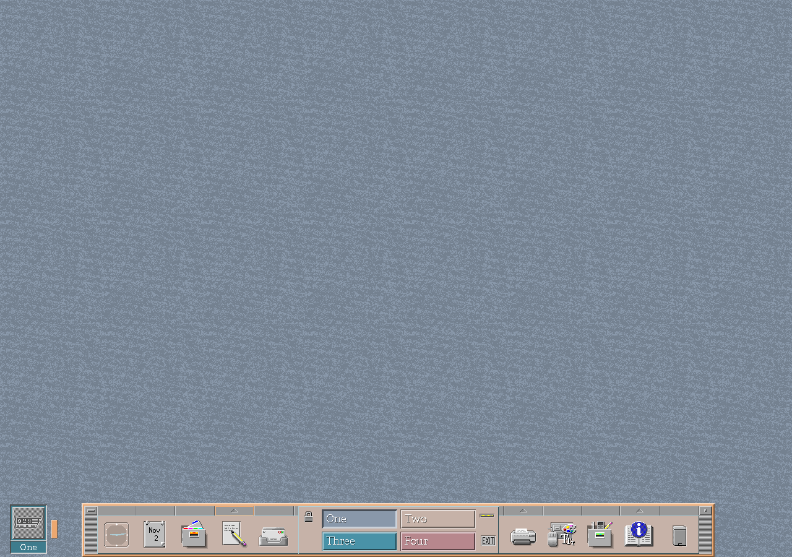
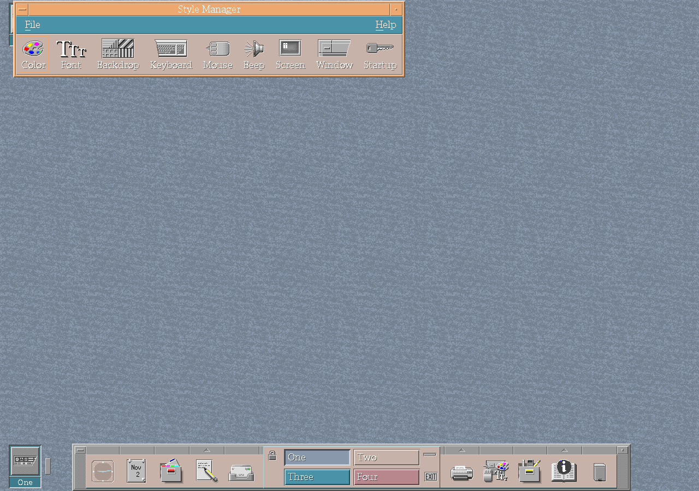
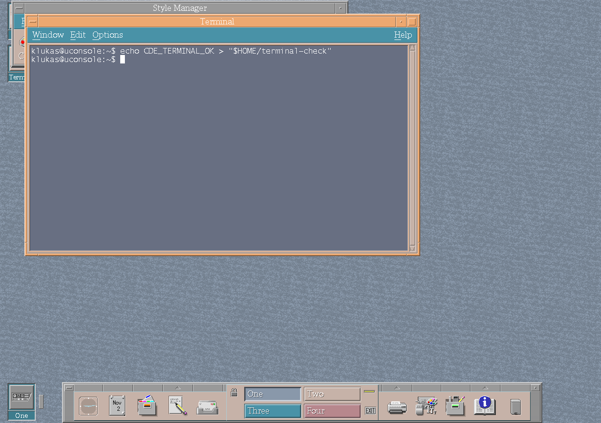
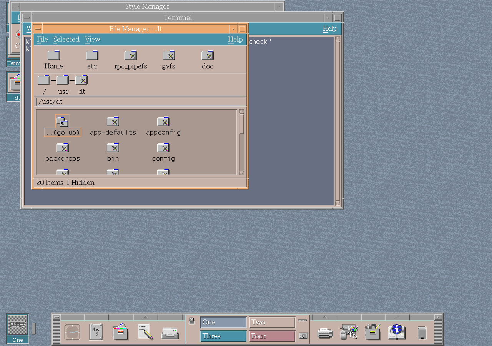

# The desktop and its tools

These screenshots come from a clean CDE session launched through
`/usr/dt/bin/Xsession` on Debian ARM64. The smoke test creates a private home,
starts a 1280 by 900 X server, waits for the CDE Front Panel, and opens the
installed Style Manager, Terminal, and File Manager.

The capture records the executable and mapped `libXm.so.9` path for every
running CDE process. This verifies that the session shown here uses the CK Core
Motif revision recorded with the images.

## Default desktop

## Style Manager

## Terminal

The smoke test enters a command through the visible Terminal window and checks
the file produced by that command before capturing the screen.

## File Manager

The File Manager opens the staged `/usr/dt` installation used by the session.

## Capture provenance

The current images were generated by the uConsole smoke test from the source in
this documentation commit, built on base commit
`05ef9c5576e6e32accaaad0a03af8949857dfc02`, and CK Core Motif commit
`8b5f7b0927fa1c2314770cc1d95150c95c3dc73d`. The adjacent
[process and mapped-library record](images/smoke-test-processes.txt),
[Motif source revision](images/motif-revision.txt), and
[Motif library checksum](images/motif.sha256) are the retained runtime
evidence.
