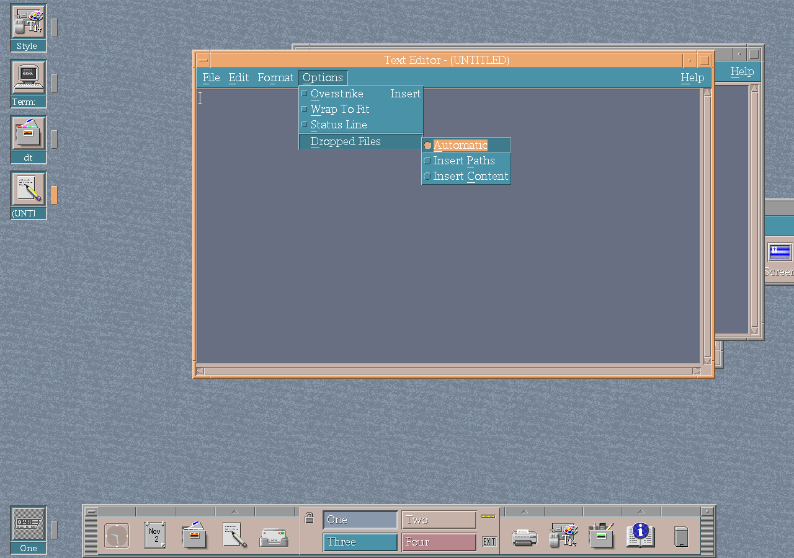

# Editor drop handling

CDE Editor offers three meanings for a file drop:

- **Automatic** uses desktop type information to select suitable behavior;
- **Insert Paths** inserts the dropped filenames; and
- **Insert Content** reads the files into the document.

*The three dropped-file modes in CDE Text Editor.*

The Options → Dropped Files submenu exposes the choice. The selected mode is
saved in `~/.dt/dtpadrc`, applied to the editor widget and propagated when an
editor is opened through ToolTalk.

This makes the same drop gesture useful for writing a list of paths as well as
combining text files.

## Save As starting directory

The Save As dialog starts in the directory of the file being edited, or in the
directory of the last file operation, or in the current directory of the
process. The text that becomes that directory is bounded: a directory that
leaves no room for the dialog's mask is not used, and the current directory is
used instead. The directory of a file name typed in the dialog is taken up to
its last slash, so a long typed path cannot overflow the buffer that holds it.
The logic is in `programs/dtpad/dirselect.c`, which has no Motif dependency and
is tested on its own by `programs/dtpad/tests/check-dirselect.py`.

## Tabbed documents, recent files, line numbers, and crash-recovery autosave

`dtpad` also provides optional modern editing conveniences across both Wayland
and X11 sessions while keeping a single-document window completely chrome-free
until a second tab is opened:

- **Tabbed documents:** **File → New Tab** (`Ctrl+T`), **File → Open in New
  Tab...**, **File → Close Tab** (`Ctrl+W`), `Ctrl+Tab` / `Ctrl+Shift+Tab`
  tab cycling, and a collapsible top tab bar (`+` button and per-tab dirty `*`
  markers) that appears automatically when two or more documents are open.
- **Recent files (`~/.dt/dtpad.recent`):** **File → Open Recent** tracks the ten
  most recently opened or saved files in MRU order with atomic `0600` updates.
- **Line-number gutter:** **Options → Show Line Numbers** (`Dtpad*showLineNumbers`
  persisted in `~/.dt/dtpadrc`) toggles a `48 px` right-aligned line-number
  margin drawn with the editor widget's `XmNrenderTable` and aligned directly to
  each wrapped or unwrapped line's `XmTextPosToXY` glyph baseline across UTF-8
  documents.
- **Multi-language syntax highlighting:** **Options → Syntax Highlighting**
  (`Dtpad*syntaxHighlighting` persisted in `~/.dt/dtpadrc`, enabled by default)
  automatically detects file extensions and `#!` shebangs for C/C++, Shell/Bash,
  JSON, JavaScript/TypeScript, Python, YAML/TOML/INI, XML/HTML/SVG, CSS,
  Markdown, Makefile/CMake, Rust/Go, SQL, and Diff/Patch (`programs/dtpad/padSyntax.c`).
  Token spans are colored non-destructively via CK Core Motif's
  `XmTextSetColorSpans` API with automatic background-luminance adaptation so
  keywords, strings, comments, numbers, preprocessor directives, and types stay
  high-contrast on both dark and light CDE palettes.
- **Crash-recovery autosave (`~/.dt/dtpad-autosave/`):** Unsaved edits are
  periodically checkpointed to `0600` swap files keyed by canonical path and
  owner PID. Normal **Save** and clean **Close** remove the swap file; if the
  editor or session terminates abruptly (`SIGKILL` / power loss), reopening the
  file restores the unsaved buffer and marks it modified so the user can review
  and save or discard it. Both `programs/dtpad/padFeatures.c` and
  `programs/dtpad/padSyntax.c` run under AddressSanitizer and
  UndefinedBehaviorSanitizer via `programs/dtpad/tests/check-pad-features.py`.
