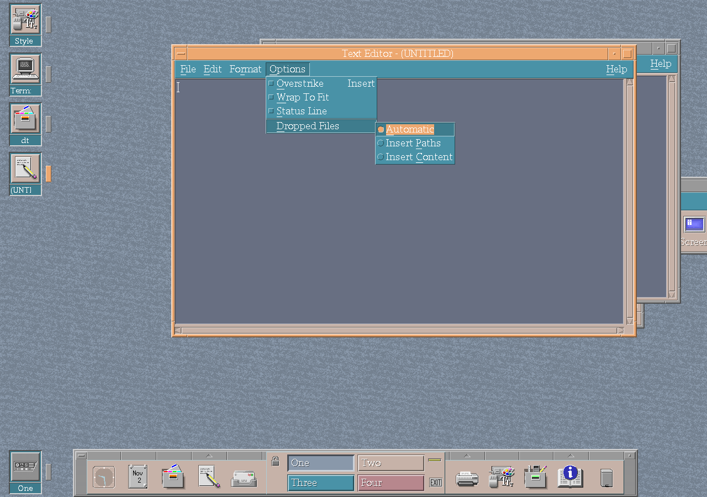

# Editor drop handling

CDE Editor offers three meanings for a file drop:

- **Automatic** uses desktop type information to select suitable behavior;
- **Insert Paths** inserts the dropped filenames; and
- **Insert Content** reads the files into the document.

*The three dropped-file modes in CDE Text Editor.*

The Options → Dropped Files submenu exposes the choice. The selected mode is
saved in `~/.dt/dtpadrc`, applied to the editor widget and propagated when an
editor is opened through ToolTalk.

This makes the same drop gesture useful for writing a list of paths as well as
combining text files.

## Save As starting directory

The Save As dialog starts in the directory of the file being edited, or in the
directory of the last file operation, or in the current directory of the
process. The text that becomes that directory is bounded: a directory that
leaves no room for the dialog's mask is not used, and the current directory is
used instead. The directory of a file name typed in the dialog is taken up to
its last slash, so a long typed path cannot overflow the buffer that holds it.
The logic is in `programs/dtpad/dirselect.c`, which has no Motif dependency and
is tested on its own by `programs/dtpad/tests/check-dirselect.py`.
