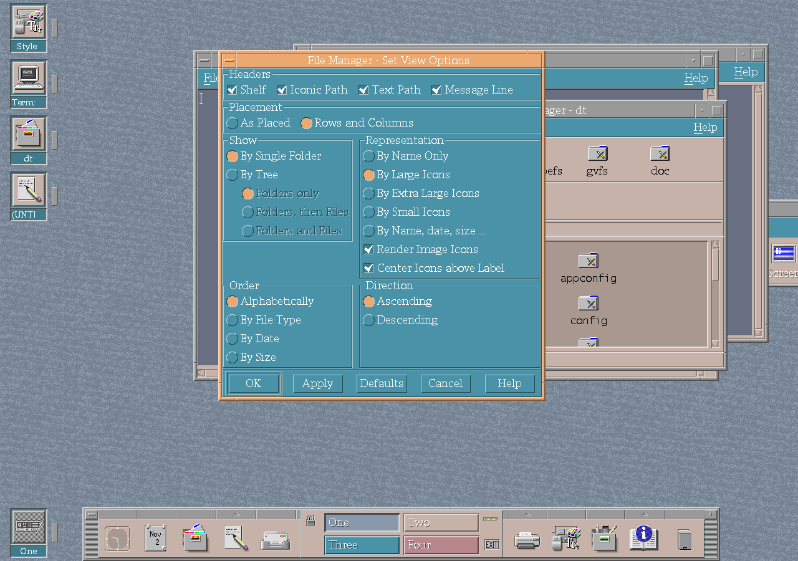

# File Manager improvements

Folder-operation feedback distinguishes completed, partial, failed and cancelled
work. Cancellation or an explicit overwrite skip blocks deletion of a move's source.
Cancellation reports that it is settling, then leaves the final result visible;
only successful completion can close the progress window automatically.

File-copy transfers complete each input block even when the operating system
accepts only part of a write. Interrupted reads and writes are retried; a zero-byte
write is reported as an I/O error. The first transfer error is retained while
both descriptors are closed, and delayed close failures are reported before
the copy is accepted. The transfer regression injects these conditions into
the production copy routines and checks copied bytes and source preservation.
An ignored copy error is tracked separately from successful completion.
Cross-filesystem moves retain their source if any file or recursive child was
not copied completely, even when the user chooses to ignore the error.

Recursive copy and delete operations allocate complete child paths instead of
appending names to fixed buffers. Cross-filesystem moves likewise check the
complete source parent. Directory iteration retries interruption and reports
other read and close errors. Symbolic-link copies grow their read buffer when
it fills, preserving the complete link target. The filesystem regression covers
deep fixture paths longer than 1024 bytes, directory errors and link growth.

CK Core CDE develops File Manager as a visual workspace rather than only a
directory browser.

## Shelf and path interaction

The shelf keeps frequently used files and directories close to the current
view. Shelf items support opening, running, rearranging and file operations.
IconicPath entries expose the same popup interaction expected from other path
components.

## Richer views

- supported image files can render their own content as icons;
- extra-large presentation and additional Icon Editor zoom levels are
  available;
- icon and shelf layouts account for labels and center their content; and
- a Storage Size dialog reports detailed use for a selected object.

*File Manager exposes the new view controls together in Set View Options.*

File actions also accept filenames containing quotes and backslashes.

The [desktop gallery](../desktop.md#file-manager) shows File Manager browsing
the staged CDE installation.
