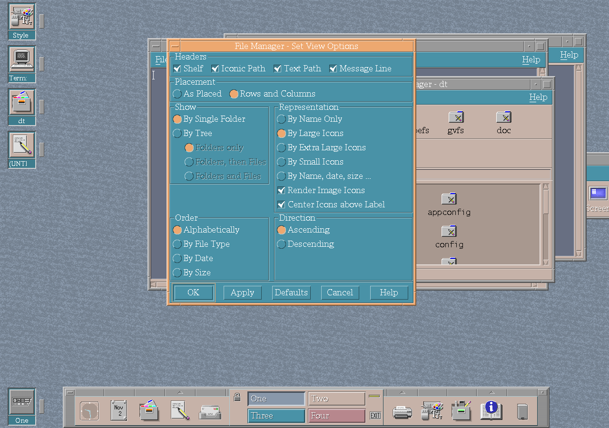

# File Manager improvements

An optional native [folder comparison window](folder-comparison.md) opens from
**File → Synchronize Folders...** when CDE is built with `--with-ck-core-fs`
and installed ck-core-fs-lib 0.3 or newer. It provides paged comparison, metadata
assessment, byte/date filters, scoped matching-rule review and saved named
preferences. Apply remains compile-time disabled: operation choices preview a
plan, and mirror/two-way execution is not delivered.

The ordinary **Copy to...** and **Move to...** commands still perform file
operations through the existing helper. They are separate from the new window's
read-only Copy/Update plan modes. The [design and delivery status](file-operations-design.md)
documents the remaining execution and reconciliation requirements.

Folder-operation feedback distinguishes completed, partial, failed and cancelled
work. Cancellation or an explicit overwrite skip blocks deletion of a move's source.
Cancellation reports that it is settling, then leaves the final result visible;
only successful completion can close the progress window automatically.

File-copy transfers complete each input block even when the operating system
accepts only part of a write. Interrupted reads and writes are retried; a zero-byte
write is reported as an I/O error. The first transfer error is retained while
both descriptors are closed, and delayed close failures are reported before
the copy is accepted. The transfer regression injects these conditions into
the production copy routines and checks copied bytes and source preservation.
The regular-file fallback used directly by File Manager follows the same
completion rule: a failed destination close blocks source removal during a
cross-filesystem move, including when no error-dialog callback is installed.
Dropped or pasted buffers are written completely before success is sent to the
parent window. Invalid lengths, missing nonempty data, zero-progress writes and
delayed close failures report an error; an empty buffer creates an empty file.
New targets are created exclusively. An unexpected existing file or symbolic
link is rejected rather than overwritten; approved buffer replacement removes
the old target through the existing conflict workflow before creation.
For multi-file operations, a later successful item does not erase an earlier
transfer or preflight failure in the result returned to the parent window.
Dismissing a subsequent conflict dialog likewise retains an earlier failure.
A desktop drop whose source cannot be resolved reports that error and skips
that item instead of passing a missing source into the transfer routine.
Failed transfers attempt to remove their newly created incomplete destination;
cleanup failure can leave it in place. These legacy operations do not provide
crash recovery or transactional replacement.

An ignored copy error is tracked separately from successful completion.
Cross-filesystem moves retain their source if any file or recursive child was
not copied completely, even when the user chooses to ignore the error.

Recursive copy and delete operations allocate complete child paths instead of
appending names to fixed buffers. Cross-filesystem moves likewise check the
complete source parent. Directory iteration retries interruption and reports
other read and close errors. Symbolic-link copies grow their read buffer when
it fills, preserving the complete link target. The filesystem regression covers
deep fixture paths longer than 1024 bytes, directory errors and link growth.

Directory refresh also validates the complete worker message and bounds file
names, relative symbolic-link expansion, data types and action labels before
encoding them for the browser. An oversized or incomplete entry is rejected as
one failed refresh response, so it cannot install partial metadata or overwrite
a fixed buffer. If account lookup is temporarily unavailable, icon-position
storage uses the numeric user ID instead of dereferencing a missing account.
Refresh-time child paths and cached modified-subdirectory paths use the same
bounded join. Attribute view also bounds owner, group and symbolic-link display
text and shows a placeholder if an unusual timestamp cannot be converted,
rather than allowing account data or formatting failures to corrupt the row.
Copy, move and link dialogs compose their selected-object captions as Motif
strings, so a translated caption or long object name is not copied through a
fixed text buffer. Their destination and preview paths are joined with explicit
capacity checks; an oversized resolved path is rejected before an operation is
started instead of being truncated or copied past the target buffer.
The final host, parent directory and leaf split is also transactional. It uses
the source directory—not uninitialized destination storage—to decide how to
join a relative name, preserves the root parent for `/name`, and reports an
invalid or oversized target before file creation or transfer setup begins.
Workspace icons affected by a completed move follow the same bounded path
rules. Overlong or malformed refresh paths are ignored without changing the
completed file operation, parent-directory matching observes component
boundaries, and refreshed desktop metadata replaces its owned optional strings
without duplicate allocation or null-string copies.
Conflict review cancellation is a terminal non-success outcome: work completed
before cancellation remains in place, but the operation is not reported as
successfully complete. When several conflict rows fail while the worker drains
the batch, the first failure remains the operation result; later transfer,
rollback, cleanup or protocol failures cannot hide its original cause.
Background operation control messages are also written completely, with
interrupted and partial writes handled and a closed reader reported without a
fatal `SIGPIPE`. If the parent channel is lost before a modification notice,
the worker stops before changing that item; if final status cannot be
published, the worker exits unsuccessfully instead of claiming completion.

CK Core CDE develops File Manager as a visual workspace rather than only a
directory browser.

## Shelf and path interaction

The shelf keeps frequently used files and directories close to the current
view. Shelf items support opening, running, rearranging and file operations.
IconicPath entries expose the same popup interaction expected from other path
components.

The initial shelf frame uses a deterministic small-icon placeholder until the
dialog's saved view data is available. Applying the real view then rebuilds the
shelf at its selected icon size; startup never reads an uninitialized view.

## Richer views

- supported image files can render their own content as icons;
- extra-large presentation and additional Icon Editor zoom levels are
  available;
- icon and shelf layouts account for labels and center their content; and
- a Storage Size dialog reports detailed use for a selected object, counting
  apparent byte size across every regular filename while deduplicating physical
  disk blocks (`st_blocks * 512`) per unique `(st_dev, st_ino)` inode and
  reporting unique hardlinked inodes alongside their additional directory names
  (`Hardlinked files: N (M additional names)`).

Path input resolution (`_DtPathFromInput`) expands `$VAR` and `${VAR}`
environment references directly in process without invoking `/bin/sh`, and
parent-directory (`_DtPName`), path-join (`_DtBuildPath`) and symbolic-link
resolution (`_DtFollowLink`, `_DtResolveAppManPath`) enforce `MAXPATHLEN`
bounds and handle relative links without directory separators.

*File Manager exposes the new view controls together in Set View Options.*

File actions also accept filenames containing quotes and backslashes.

## XDG MIME associations, `dtopen`, and *Open With...* (`WP-12`)

- **Interactive *Open With...* dialog (`OpenWith.c`):** Selecting one or more
  files and choosing **Selected → Open With...** or right-clicking a file and
  choosing **Open With...** detects the target file's MIME type (magic-header
  inspection plus extension/XDG lookup), ranks compatible XDG `.desktop`
  handlers ahead of general applications, previews or edits the expanded command
  line, and optionally persists the user's choice to
  `~/.config/mimeapps.list` (`[Default Applications]` and
  `[Added Associations]`).
- **Modernized `dtopen` and datatypes:** `dtopen` (`dtopen_image`, `dtopen_pdf`,
  `dtopen_ps`, `dtopen_video`, `dtopen_audio`, `dtopen_office`, `dtopen_any`)
  consults `dtappintegrate-xdg --open-mime` (`~/.config/mimeapps.list`) first,
  then modern Linux viewers (`papers`, `evince`, `okular`, `loupe`, `eog`,
  `mpv`, `vlc`, `libreoffice`, `ck-browser`), and finally `xdg-open`. Built-in
  CDE datatypes (`datatypes.dt`) include `WEBP`, `SVG`, `VIDEO_MODERN` (`.mp4`,
  `.mkv`, `.webm`), `AUDIO_MODERN` (`.mp3`, `.flac`, `.ogg`, `.opus`, `.m4a`),
  and `OFFICE_DOC` (`.odt`, `.ods`, `.odp`, `.docx`, `.xlsx`, `.pptx`).

## Removable media (`UDisks2`), network shares (`GVFS`), built-in archives, shared thumbnails, live XDG Trash, and `FileManager1` (`WP-16`)

`dtfile` shares a unified removable-device, network-mount, archive, thumbnail,
trash, and session D-Bus layer across both `CDE (Wayland)` and `CDE (X11 /
XLibre)`:

- **Removable USB/SD & encrypted LUKS volumes (`Devices.c`):** Subscribes to
  `org.freedesktop.UDisks2` (`ObjectManager` + live `InterfacesAdded`,
  `InterfacesRemoved`, and `PropertiesChanged` signals), dynamically surfacing
  hotplugged USB/SD/MMC drives and encrypted `crypto_LUKS` volumes in `dtfile`'s
  Shelf, **File → Connected Mounts & Devices...**, **File → Go To...**
  (*Connected Mounts & Shares* tab), and **View → Mounts & Devices...**.
  Activating a locked LUKS volume opens a Motif passphrase dialog
  (`Encrypted.Unlock` followed by `Filesystem.Mount`, zeroing passphrase buffers
  immediately after marshalling), and right-clicking or using *Connected Mounts &
  Devices...* supports **Unmount** and safe **Eject / Power Off Drive**
  (`Filesystem.Unmount`, `Encrypted.Lock`, `Drive.Eject`, and `Drive.PowerOff`).
- **Network shares, SSH config remotes & MTP/PTP mobile devices (`GVFS`):**
  **File → Connect to Server...** mounts `smb://`, `sftp://`, `davs://`, and
  `nfs://` shares via `gio mount` (`fork`/`execvp`, never `/bin/sh`). Selecting
  **SSH / SFTP (`sftp://`)** parses `~/.ssh/config` (including `Include`
  directives and `/etc/ssh/ssh_config`, skipping wildcard patterns) and presents
  a **Configured SSH Remotes (`~/.ssh/config`)** list so known aliases populate
  the host, username, and `sftp://` URI (preserving OpenSSH `HostName`, `Port`,
  `IdentityFile`, and `ProxyJump` settings). During connection attempts, a
  dedicated **Connecting to Remote Server** progress dialog displays a 3D CDE
  progress bar, elapsed timer, and **Cancel** button (`SIGTERM`), and failed
  connections post a modal **Connect to Server Error** dialog with the attempted
  URI and `gio mount` diagnostics. `/run/user/$UID/gvfs` is watched via
  `inotify` so remote shares and hotplugged MTP/PTP phones appear automatically
  with one-click **Disconnect / Unmount** (`gio mount -u`).
- **Tabbed *Go To...* navigation (`ChangeDir.c`, `XmTabStack`):** **File → Go
  To...** provides a two-tab Motif `XmTabStack` (**Folder History** and
  **Connected Mounts & Shares**), allowing users to browse visited folders or
  immediately inspect, mount/unlock, disconnect, or open any connected GVFS
  share, MTP phone, removable/LUKS volume, or local filesystem.
- **Built-in archive actions & Zip-Slip defense (`Archive.c`):** **Selected**
  and right-click object popup menus provide **Extract Here**, **Extract To...**,
  and **Compress...** supporting `.zip`, `.tar.gz`/`.tgz`, `.tar.xz`/`.txz`,
  `.tar.zst`/`.tzst`, `.tar.bz2`, `.tar`, and `.7z` via `libarchive` (preserving
  UTF-8 filenames via thread-scoped `C.UTF-8` `uselocale()`). Extraction
  validates every archive entry in a preflight pass—rejecting absolute paths,
  `..` traversal, NUL/control bytes, device/FIFO special nodes, and symlink or
  hardlink target escapes—and materializes entries into a sibling staging
  directory strictly via descriptor-relative `openat`/`mkdirat`/`symlinkat`/
  `linkat` with `O_NOFOLLOW`.
- **Shared FreeDesktop thumbnails (`Thumbnails.c`):** When `renderImageIcons` is
  enabled (`Dtfile*renderImageIcons: True`), `dtfile` resolves cached PNG
  previews from `$XDG_CACHE_HOME/thumbnails/{large,normal}/<md5(URI)>.png`
  (checking both GLib `g_filename_to_uri` and strict RFC-3986 `file://` URI
  encodings and validating `Thumb::MTime` / mtime freshness) for PDFs, videos,
  SVGs, WebP, and office documents, alongside direct `.png` previews loaded via
  `libXm.so.9`.
- **Live bidirectional XDG Trash & per-mount `.Trash-$UID` (`XdgTrashSync.c`):**
  Watches `$XDG_DATA_HOME/Trash/{files,info}`, `~/.dt/Trash`, and active
  `<mount>/.Trash-$UID/{files,info}` directories via `inotify`, synchronizing
  items trashed or restored by external GTK/Qt/CLI applications live and
  non-destructively in both directions while trashing files on external USB/SD
  mounts in `O(1)` on the same filesystem (`<mount>/.Trash-$UID`).
- **`org.freedesktop.FileManager1` D-Bus service (`FileManagerService.c`):**
  Registers `org.freedesktop.FileManager1` on `/org/freedesktop/FileManager1`
  (with `/usr/share/dbus-1/services/org.freedesktop.FileManager1.service`
  auto-activation), implementing `ShowFolders`, `ShowItems` (raising/activating
  the target `dtfile` window and highlighting the requested files),
  `ShowItemProperties` (opening CDE's Permissions/Properties dialog), and
  `Hostname`.

## Browser ergonomics: tabs, live search, file clipboard, and session undo (`WP-17`)

`dtfile` supports everyday keyboard- and pointer-driven browser ergonomics across
both `CDE (Wayland)` and `CDE (X11 / XLibre)` while preserving classic single-tab
appearance when only one tab is open:

- **Multi-tab browsing & navigation shortcuts (`BrowserErgonomics.c`):** Press
  `Ctrl+T` (**File → New Tab**), middle-click (`Button2` click without drag) a
  folder icon, or choose **Open in New Tab** from a folder's right-click menu to
  open up to 16 tabs per window. The tab strip appears automatically whenever two
  or more tabs are open, providing `<` / `>` Back/Forward buttons, active-tab
  highlighting, per-tab `x` close buttons, and a `+` new-tab button. Cycle tabs
  with `Ctrl+Tab` / `Ctrl+Page_Down` and `Ctrl+Shift+Tab` / `Ctrl+Page_Up`, close
  the active tab with `Ctrl+W` (**File → Close Tab**), step through each tab's
  64-entry navigation history with `Alt+Left` / `Button8` and `Alt+Right` /
  `Button9`, ascend to the parent folder with `Alt+Up`, start inline fast-rename
  with `F2`, and toggle dot-files with `Ctrl+H`.
- **Asynchronous in-window search (`Ctrl+F`):** Press `Ctrl+F` (**File → Search
  in Window...**) to open the collapsible two-row search bar without leaving the
  active window. When built with `--with-ck-core-fs`, searches run on
  `ck-core-fs-lib`'s cancellable `ckfes_*` worker (`ck_fs_search.h`), filtering
  by filename substring or glob (`*`, `?`, `[...]`), regular-file text content
  (skipping NUL-containing binary files), optional subfolder recursion and case
  matching, minimum/maximum byte sizes (`K`/`M`/`G` suffixes supported), and
  `YYYY-MM-DD` modified-date bounds. Matches stream live into the results list
  with **Open**, **Open in New Tab**, **Reveal in Folder** (navigating to the
  matched entry's parent folder and scrolling/selecting the icon), **Stop**, and
  `Escape` dismissal.
- **Cross-toolkit file clipboard (`Ctrl+C` / `Ctrl+X` / `Ctrl+V`):** **Selected →
  Cut / Copy / Paste** and `Ctrl+X` / `Ctrl+C` / `Ctrl+V` (outside text fields)
  publish and consume `x-special/gnome-copied-files`, `text/uri-list` (RFC-3986
  `file://` URIs), and `UTF8_STRING` paths on `CLIPBOARD`, interoperating between
  `dtfile` windows and native Wayland (`wl_data_device` /
  `zwlr_data_control_v1`) or X11 GTK/Qt peers. Pasting copied items into their
  source directory creates non-destructive `<stem> (copy)<ext>` duplicates.
- **Bounded per-session undo journal (`Ctrl+Z`):** **Selected → Undo** (`Ctrl+Z`)
  maintains a 64-entry per-session undo stack reversing **Rename**, **Move**,
  **Copy** (moving newly created copies into XDG Trash rather than unlinking
  permanently), and **Put in Trash** (restoring items and removing companion
  `.trashinfo` records).

The [desktop gallery](../desktop.md#file-manager) shows File Manager browsing
the staged CDE installation.
