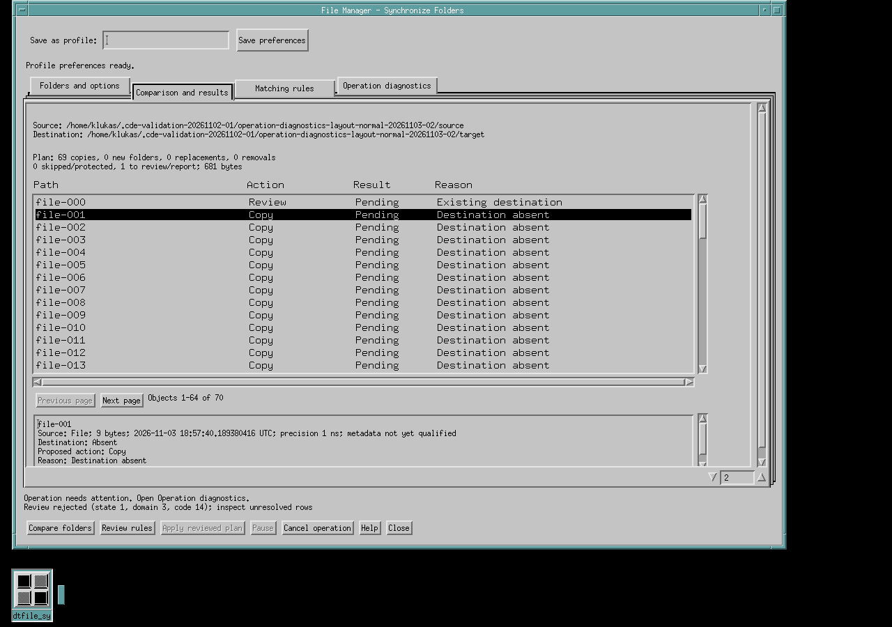

# Compare folders

The optional **File → Synchronize Folders...** command opens a native comparison
window. It inventories two folders, shows their differences and evaluates
matching rules. **Apply reviewed plan is disabled in the current build.** The
helper does not copy, replace, move or delete either folder's contents. Two-way
reconciliation and mirror execution are not delivered.

The ordinary File Manager **Copy to...** and **Move to...** commands continue to
perform file operations through the existing copy/move helper. Choosing **Copy**
in this comparison window selects a proposed policy; it does not run that legacy
copy command.



Read-only comparison in the native helper. Apply remains disabled.

## Enable the optional helper

The default CDE build has no filesystem-library dependency and does not include
this command. To build `dtfile_sync`, install **ck-core-fs-lib 0.3 or newer**, point
pkg-config at that installation and configure CDE with `--with-ck-core-fs`:

```sh
PKG_CONFIG_PATH="/absolute/fs-prefix/lib/pkgconfig${PKG_CONFIG_PATH:+:$PKG_CONFIG_PATH}" \
  ./configure --with-ck-core-fs
```

Run this from the CDE source/build configuration directory, keeping the other
options and CK Core Motif setup described in the [build guide](../build.md).
Use the installation's actual pkg-config directory, which may be `lib64/pkgconfig`.
Keep the selected shared library available to the desktop session at runtime.
For a custom prefix, add its library directory to the configured runtime linker
path, for example with `LDFLAGS="${LDFLAGS:+$LDFLAGS }-Wl,-rpath,/absolute/fs-prefix/lib"`,
following the Motif setup in the build guide, or use the system loader's library
installation path. The native qualification uses explicit frozen library paths.
The helper also requires C11 atomics and the platform's `closefrom` capability.
It closes inherited descriptors above standard input/output/error immediately
after exec, before locale/catalog, display or worker initialization, so File
Manager's cache and IPC descriptors do not remain open in the helper. Configure
link-checks `closefrom` together with the required tree API. An explicit request
fails if these capabilities or the library/version are unavailable; a version
label alone is insufficient. Enabling the helper does not enable Apply.

Changing this configure option updates a private generated menu header. An
incremental build automatically rebuilds the affected File Manager menu; a
clean build is unnecessary.

## Start a comparison

The three notebook tabs are at the top. Each page scrolls independently when
its content exceeds the available space. The initial window size is bounded by
the actual screen so the bottom action buttons remain visible.

1. Open the source folder in File Manager and choose **File → Synchronize
   Folders...**. The current view supplies the source, independently of selected
   objects. The command is unavailable in restricted/toolbox views.
2. In **Folders and options**, choose a destination with **Browse...**, or enter
   absolute source and destination paths. **Swap folders** reverses their roles
   without moving either folder or changing the selected policy. Folder names
   retain their original native bytes when swapped, including escaped names
   selected through Browse or loaded from a saved profile.
3. Keep **Compare only**, or choose a policy to inspect its proposed plan.
   **Copy**, **Update: protect destination-newer**, **Copy missing only**,
   **Synchronize one way** and **Mirror** are preview modes here. Even proposed
   mirror removals are never executed. The explanation below the operation menu
   describes the selected policy and its direction before you compare.
4. Choose the metadata scope and optional byte/date bounds, then select
   **Compare folders**. **Clear filters** removes the four byte/date bounds
   while keeping the folders, operation, metadata scope and matching rules.
   Changing folder options requires another comparison. Existing results remain
   available to inspect with an earlier-options notice; rule review stays
   disabled until the new comparison completes.
5. In **Comparison and results**, use **Previous page** and **Next page** and
   select a row to inspect both versions, the reason and applicable proposed
   names. Plan totals describe proposed copies, new folders, replacements,
   removals, skipped/protected objects and bytes; incomplete totals are labelled.

Starting another comparison clears the previous plan, rows, page information,
details and row-scoped rules after the old worker has stopped. Reusable job
preferences are retained and require a fresh review. If setup validation or
worker startup fails, the folder options and **Compare folders** remain
available so you can correct the problem and retry; old results are not shown
as the failed attempt's results.

Comparison reads source/destination contents and metadata. A missing attribute,
unreadable object or unsupported capability is reported as unknown or
unsupported. Equal size/time is not a claim of identical content; inspect the
reported comparison reason. Read-only comparison can still create the helper's
private journal/configuration data under your home directory.

## Metadata and filters

**Complete preservation** requests assessment of the complete metadata policy.
**Ordinary mode/times; new caller ownership** selects the narrower ordinary
policy. The detail view reports each side's metadata assessment and timestamp
precision where known. Neither selection promises that an unsupported provider
can preserve metadata, and selecting the ordinary scope does not grant a
metadata-loss override or enable writes.

Byte/date bounds select regular files; they do not apply to other object kinds.
Minimum/maximum byte fields are inclusive and accept decimal byte counts from
`0` through `18446744073709551615`, without signs, spaces or unit suffixes.
Equal minimum/maximum sizes are valid. Empty fields leave the corresponding bound
unset. **Modified on/after** is inclusive; **Modified before** is exclusive.
Bounds accept a local calendar date such as
`2026-11-02`, or an exact UTC timestamp such as
`2026-11-02T12:34:56.123456789Z`. A date alone means local midnight. Saved bounds
reload as UTC timestamps with their fractional precision, so changing the time
zone does not move the saved interval. Invalid or reversed bounds are rejected
before a worker starts. The window returns to **Folders and options**, explains
the specific problem and selects the field to correct. Both folder fields must
be filled in with absolute paths. Filesystem availability and capabilities are
assessed by the backend during comparison.

The current window uses all object kinds and a fixed recursion-depth limit of
1024. Pattern editors, mount-boundary controls and configurable depth are not
part of this window.

## Review matching rules

In **Matching rules**, select a matching class and an available action, then
choose one of these scopes:

- **All matching in job**: reusable preferences for eligible matching objects.
- **Selected matching rows**: the selected rows on the displayed page.
- **This item**: exactly one selected object.
- **Matching in selected subtree**: exactly one selected subtree root.

Choose the tie/unknown fallback and the separate **Do not replace nonempty with
empty** and **Preserve replaced versions** preferences. Add/update the rule,
then select **Review rules** to obtain backend counts and consequences. Editing
or removing a rule requires review again; only actions offered for that class
and scope can be selected.

Footer input errors and rule-command feedback remain visible while the current plan is
waiting for review. Correcting an input, selecting the required rows or issuing
a new command clears the old message; periodic polling alone does not. A fresh
comparison starts a new feedback generation. Cancellation, worker cleanup,
recovery requirements and errors from an incoherent backend view take priority.

The window holds at most 64 matching rules. Existing rules can still be updated
when all slots are occupied. Adding a new rule then asks you to remove one;
a rejected add does not change the rename side or existing decisions. Removing
a rule requires exactly one rule selected in the list.

A reviewed rename belongs to its selected object, basename and incoming/target
side. Changing any part requires review again, including choosing a different
row while a basename is entered. Repainting an unchanged selection does not
require another review. An allocation failure while reading rename input aborts
the review request instead of dropping the rename.

“Resolved” in a rule count means that the rule resolved a matching case in the
**proposed plan**. It does not mean files were changed. Keep Both, reviewed rename and
preservation controls describe proposals; they do not perform retention or
renaming while Apply is disabled. Unsupported choices remain unavailable or
unresolved. A new comparison discards item/selection/subtree decisions; its
retained job-wide preferences must be evaluated against the new inventory.
An Ask rule may remain unresolved in its own counts during Compare review:
Compare reports differences without approving a filesystem change. Selecting a
copy/update policy still requires a fresh comparison and decision review.

Compare works without a journal directory or `HOME`; unavailable saved
preferences do not prevent it. Other operation previews currently require
private operation state.

## Save, load and delete preferences

Enter a profile name and select **Save preferences**. Select an existing entry
and use **Load selected preferences** to restore it. **Delete profile** asks for
confirmation and removes only the named preferences, never the compared files.
The status line reports asynchronous load/save/delete completion or failure.
Saving an existing name updates that entry.

Profiles preserve the exact source/destination path bytes, operation and metadata
choices, filter bounds and reusable job-wide rules. Saving is refused while
item, selection or subtree decisions are in the rule list. Profiles contain no
row identities, comparison generations, execution receipts or synchronization
history. Loading one always requires a fresh comparison and review. Loading
prepares both folder names before applying the profile. If preparation fails,
the current folders, options and rules remain unchanged.

The store supports at most 64 profiles, names of 1–64 UTF-8 bytes, 64 job-wide
rules per profile and 65,536 bytes per native folder path. Limits are reported
rather than truncating or discarding entries. Preferences live in
`$HOME/.dtfile-sync/profiles.v1`, in an owner-only `0700` directory with regular,
single-link `0600` files. The helper also checks the access path and macOS ACLs;
mode bits alone do not establish privacy. Saves merge the latest valid database
under a cooperative lock, then write/flush/rename/flush atomically. Corrupt,
unreadable or unsafe stores are reported and retained, not silently reset. A post-rename flush
failure reports uncertain durability. Volumes mounted with ownership disabled
are refused for preferences; this does not imply that every filesystem's
security semantics have been qualified.

## Native names and cancellation

Folder paths supplied by File Manager, a chooser or a saved profile keep their
exact POSIX bytes separately from their presentation. Non-ASCII/control bytes
and backslashes may appear as `\xNN`; a long result label may be shortened.
Display labels are not native paths or rule identities. Editing a folder field
replaces its retained native value with the literal entered text; `\xNN` is not
parsed back into a filename. Use the chooser or reload the profile to retain an
unusual existing path without retyping its display label.

**Pause** requests a safe pause; **Resume** clears that request. **Cancel
operation** acknowledges cancellation and waits for safe cleanup while the
window stays responsive. **Close** also stops the comparison and preference
workers, waiting for actual worker/resource drain before the process exits.
A terminal progress label alone does not mean native cleanup has finished.

The [design and delivery status](file-operations-design.md) separates this
read-only workflow from future execution and two-way reconciliation requirements.

## Run focused checks

With the optional backend selected, run `make -j1 -C programs/dtfile check`.
The installed-library controller fixture verifies native inventory and paging,
review receipts, transport failures, cancellation and an actual ordinary copy
inside disposable fixtures. The profile fixture exercises the production
parser, concurrent saves, privacy and atomic persistence.

The native setup and retry regression additionally needs Xvfb, `xvfb-run`,
`xauth` and the installed Motif and filesystem SDK prefixes. From the configured `cde/`
directory, run it on a private X display with a new work directory:

```sh
xvfb-run -a python3 programs/dtfile/tests/check-sync-retry-ui.py \
  --fs-prefix /path/to/filesystem-prefix \
  --motif-prefix /path/to/motif-prefix \
  --work-dir "${DTFILE_PRIVATE_TEST_ROOT:-$TMPDIR}/dtfile-retry-check"
```

It uses real widgets, production callbacks and the installed backend to check
policy explanations, byte-preserving swaps, clearing filters and focused setup
validation. It then compares, fails a Copy preview with `HOME` absent and retries
Compare, checking cleared rows/details/actions and retained job preferences. It
does not apply file operations to either tree. Its real preferences worker
writes only inside a disposable private fixture; the work directory needs
trusted, non-group-writable ancestors. UI allocation faults verify atomic
profile loading and aborting an unreadable rename input; real review receipts
verify side and selected-row invalidation. It also checks retained input feedback,
selection-based clearing, updates at the 64-rule limit, profile availability,
and cancellation/Close feedback priority. `result.json` and logs record the run.

Set `TMPDIR` explicitly. Private test homes must be on an ownership-enforcing
filesystem with trusted ancestors; if that differs from the build's temporary
location, set `DTFILE_PRIVATE_TEST_ROOT` to an existing suitable fixture directory.
The access-path validator also supports unprivileged user namespaces, where the
host-owned filesystem root can appear with an unmapped UID. That exception is
limited to the descriptor opened directly as `/`; every ordinary ancestor and
private object keeps the ownership, permission, link and ACL requirements above.
