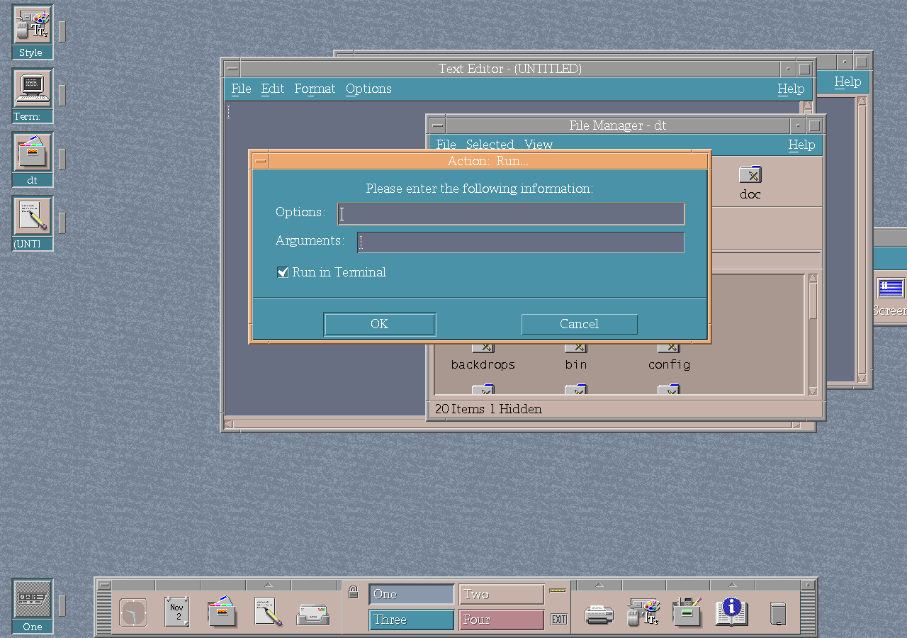

# Launching applications

Action child-process discovery uses an iterative visited queue and independent
PID parsing. Nested children cannot invalidate a parent's parser or exhaust the
C stack, and long child lists do not split PID tokens across fixed buffers.
Executable names are accepted only after their terminating NUL is read;
interrupted and short reads are handled without accepting truncated names.
List growth and joined-command allocation sizes are checked before allocation.
The regression uses a private procfs fixture with nested siblings, cycles,
long child lists, invalid IDs and interrupted reads.

CK Core CDE separates two useful launch workflows:

- **Run** starts a graphical program directly; and
- **Run...** opens the command dialog, where **Run in Terminal** can be enabled
  for an interactive command or disabled for a graphical application.

This keeps terminal-backed commands available without forcing every graphical
program through an unnecessary terminal window.

*The executable Run... action makes its Terminal choice explicit.*

## XDG application indexing and `Super` Quick Launch (`WP-12`)

- **Automatic XDG `.desktop` discovery (`dtappintegrate --xdg`):** Both
  `CDE (Wayland)` (`Xsession.wayland` and `dtsession --wayland`) and classic
  `CDE (X11 / XLibre)` (`Xsession`) run `dtappintegrate --xdg` at session start
  and start a background `inotify` watcher (`dtappintegrate --xdg --watch`).
  Installed APT, Flatpak, Snap, `/usr/local/share/applications`, and
  `~/.local/share/applications` `.desktop` entries are indexed automatically
  into `~/.dt/types/ck-xdg-apps.dt`, `~/.dt/icons/`, and categorized Application
  Manager folders (`XDG_Internet`, `XDG_Graphics`, `XDG_AudioVideo`,
  `XDG_Office`, `XDG_Development`, `XDG_Games`, `XDG_System`, `XDG_Utilities`)
  without shadowing CDE's built-in `Desktop_Apps` group.
- **`Super` / `Super+Space` / `Alt+F2` Quick Launch (`ck-launch`):** Both
  `dtwm-wayland` and classic X11 `dtwm` (via passive `Super_L`/`Super_R` tap
  detection, `sys.dtwmrc` bindings, and `_NET_CLIENT_LIST` /
  `_NET_ACTIVE_WINDOW` root properties) toggle `ck-launch --toggle` for instant
  keyboard-driven fuzzy search across XDG applications, CDE actions, open
  windows (`zwlr_foreign_toplevel_manager_v1` on Wayland; `_NET_CLIENT_LIST` /
  `_NET_ACTIVE_WINDOW` on X11), `dtstyle` settings, and inline mathematical
  expressions.
- **Front Panel *Applications* subpanel & native `dtopen` helpers:** Clicking the upward arrow above the
  Front Panel `Applications` control opens `AppsSubpanel` with one-click items
  for *Quick Launch (Super)*, *Software & Updates*, and *Reload XDG Apps*.
  CDE's `dtopen` helper chains (`dtopen_image`, `dtopen_pdf`, `dtopen_midi`,
  `dtopen_video`) and curated `Media_Tools` / `Graphics` / `Office` / `Internet`
  Application Manager groups prioritize native CK Core Motif viewers and players
  (`ck-view`, `ck-pdf`, `ck-midi`, `ck-video`, `ck-browser`) ahead of external
  toolkits.
