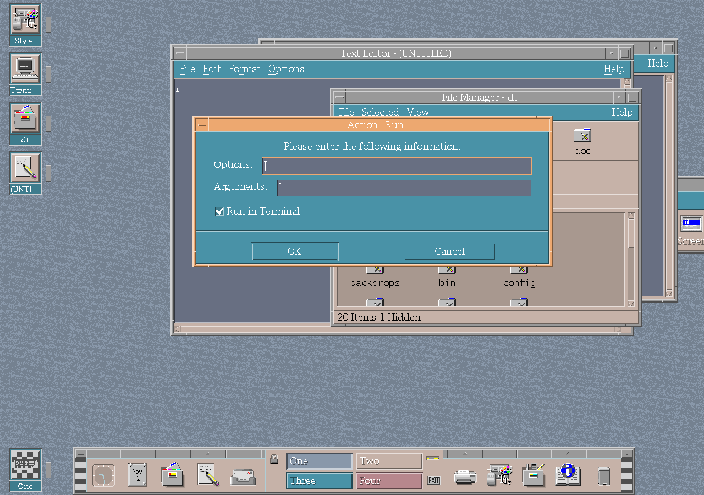

# Launching applications

CK Core CDE separates two useful launch workflows:

- **Run** starts a graphical program directly; and
- **Run...** opens the command dialog, where **Run in Terminal** can be enabled
  for an interactive command or disabled for a graphical application.

This keeps terminal-backed commands available without forcing every graphical
program through an unnecessary terminal window.

*The executable Run... action makes its Terminal choice explicit.*
