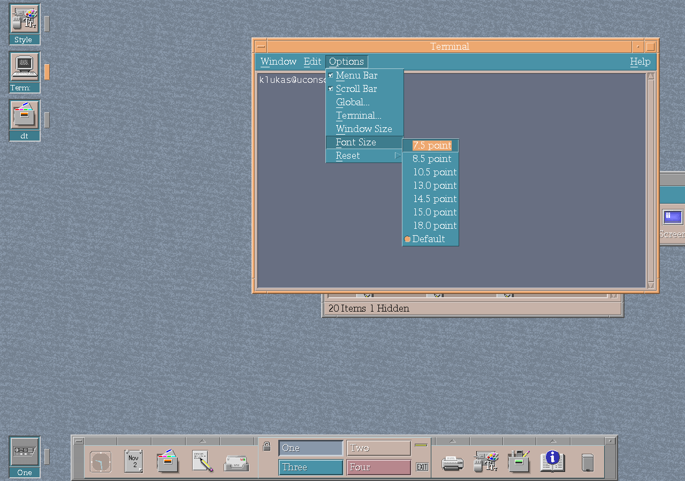

# Terminal improvements

Escape-sequence strings reserve space for a complete multibyte character and
their terminating NUL. The softkey parser stores its full length without 8-bit
wrap, checks hex digits and accepts only complete byte pairs. Excess numeric
parameters are ignored after the first sixteen, preserving the stored values
and keeping all parameter indices within bounds. The parser regression covers
UTF-8 boundary cases, 512 hex digits and long excess-parameter sequences.

CK Core CDE makes the Terminal easier to use with files and across repeated
sessions.

When `dtterm` is installed setuid root (the build does this when no utmp helper
library is available), it gives up root for good in the child process before it
starts the shell. Each step of that change is checked, the resulting real and
effective identities are verified and root must not be recoverable; if any of
that fails, the terminal stops with a message instead of running the shell with
root privileges. The same applies when the window process returns to the user's
effective identity after a privileged operation. `make -C lib/DtTerm check` runs
a test with a fake kernel for these cases.

## Drop files into the shell

Dropping one or more files into a Terminal inserts their paths at the input
cursor. Spaces, quotes and backslashes are shell-escaped, and multiple paths
are separated so the resulting command line remains editable.

## Keep the chosen font size

The Options → Font Size choice is stored in `~/.dt/dttermrc` and becomes the
default for later terminals and clones. A font size restored explicitly by a
saved session still takes precedence.

*The live Terminal font-size menu in the uConsole session.*

The [desktop gallery](../desktop.md#terminal) shows the Terminal from the ARM64
smoke session.
