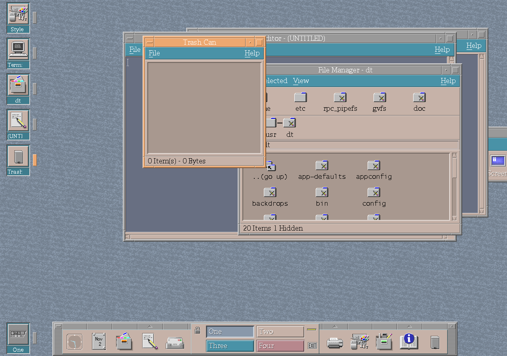

# Trash improvements

CK Core CDE records original paths, deletion dates and sizes for trashed
objects, and can import entries from the freedesktop.org Trash layout. File
operations use secure temporary files and handle longer paths more reliably.

Metadata rewrites use a unique file beside `.trashinfo`, with owner-only access.
The writer checks entry writes, flushing, file synchronization and closing before
atomically renaming the replacement over the previous metadata. A failed rewrite
preserves the previous file and removes its temporary replacement. Staging beside
the destination also permits Trash to reside on a separate mounted filesystem.
Existing metadata opened by the Trash reader is restricted to owner-only access.

The reader consumes the stored byte lengths rather than splitting filenames at
line boundaries. Spaces and newlines in names therefore remain part of their
fields. Negative, overflowing or truncated lengths, embedded NULs, invalid size
attributes and internal names that escape the Trash directory are rejected.
Deletion dates and sizes are parsed as separate attributes. A read error or
malformed record disables Trash initialization and preserves the previous
metadata, rather than rewriting a partially loaded list. Missing files are
discarded only for `ENOENT`; other lookup failures preserve the metadata.

The standalone `TrashMetadata` module has no Xt or Motif dependency. Its C
regression exercises malformed records and complete records, including multiple
records with embedded newlines and the largest unsigned stored size.

The regression in `cde/programs/dtfile/tests/check-trash-writer.py` executes the
production writer with real files and injects failures in creation, stream setup,
permissions, ownership, entry writing, flushing, synchronization, closing and
replacement. These checks run at the shared repair-batch validation checkpoint.

The desktop icon reflects whether Trash contains items. Trash actions can also
raise and focus the existing Trash window instead of opening a competing view.

*The managed Trash view and its workspace icon in the uConsole session.*

Together these changes make the desktop indicator, window and stored metadata
describe the same Trash state.
