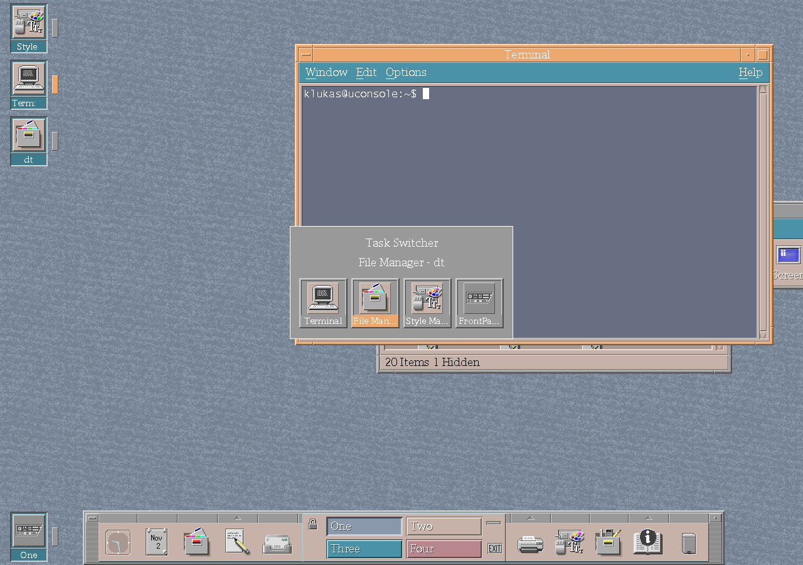

# Window management

CK Core CDE extends dtwm without replacing its workspace, icon or session
model.

## Task switching

The keyboard task switcher presents the available windows, keeps the current
selection visible and supports pointer hover and pinning. It is enabled by the
`Dtwm*showTaskSwitcher` resource.

*The keyboard task switcher running in dtwm on uConsole.*

## Movement and focus

- snap feedback previews half-screen and quadrant placement while moving;
- `Super+Left` / `Super+Right` / `Super+Up` / `Super+Down` (`f.tile_window
  left|right|up|down`) tiles the active window to halves and quadrants of the
  usable workarea (honoring the Front Panel strut), maximizes on repeated
  `Super+Up`, restores the saved pre-tile geometry on `Super+Down`, and links
  shared inner borders between adjacent tiled or edge-snapped windows so
  dragging the split divider resizes both neighbors together in lockstep while
  clamping against each window's minimum size on both X11 `dtwm` and
  `dtwm-wayland`;
- tapping bare `Super`, pressing `Super+Tab` / `Super+W` (`f.toggle_overview`),
  or performing a three-finger touchpad swipe-up on `dtwm-wayland` opens a live
  spatial workspace and window overview displaying clickable CDE workspace pills
  and scaled real-time window thumbnails (`Super+Space` and `Alt+F2` remain
  bound to `ck-launch`, or set `DTWM_SUPER_ACTION=launcher` for bare-`Super`
  launcher activation);
- holding Shift aligns movement and resize to the desktop grid;
- double-clicking a title bar maximizes or restores the window;
- clicking the desktop clears the active-window focus;
- clicking a Front Panel or subpanel item whose application is already open
  moves or switches to the window as needed, restores it if minimized, raises
  it to the foreground, and grants active keyboard focus on both X11 `dtwm` and
  Wayland (`dtwm-wayland`); and
- **Style Manager → Window** configures **Minimize / Restore Animation**
  (`Dtwm*minimizeAnimation`), **Maximize / Restore Animation**
  (`Dtwm*maximizeAnimation`), and **Animation Speed** (`Dtwm*animationSpeed`:
  `Very Quick`, `Standard` [default], and `Slow`) dynamically for the active
  backend — offering `None`, `Wireframe` (minimize default), and `Titlebar` on
  X11 `dtwm` (maximize default `None`), and `None`, `Bevel Morph` / `Bevel Glide`
  (default, with late symmetric near-icon crossfade), `Titlebar Shuttle`, and
  `Wireframe` on [Wayland (`dtwm-wayland`)](wayland.md).

Open-window desktop icons and the optional **Icon Box** (`Dtwm*useIconBox:
True`) keep running applications in invariant mental-map order across minimize,
restore, maximize, and focus changes on both X11 and Wayland. Desktop icons can
be dragged freely to any unoccupied placement-grid cell with a visual grid and
4-pixel rounded slot highlight (`f.pack_icons` / **Clean Up Icons** packs
manually placed icons back in sequence), while closing a window compacts
auto-placed icons cleanly and Icon Box resize or maximize/restore reflows rows
and columns without scrambling icon order.

## Hardware keys, 3D bevel OSD and touchpad gestures

Both `dtwm` on X11 and `dtwm-wayland` on Wayland bind standard laptop and
workstation hardware keys without stealing keyboard focus from the active
application:

- `XF86AudioRaiseVolume`, `XF86AudioLowerVolume`, `XF86AudioMute`, and
  `XF86AudioMicMute` adjust output volume and microphone mute via
  `dtwm-media-ctl` (PipeWire `wpctl`, PulseAudio `pactl`, or ALSA `libasound`)
  and display a non-focus-stealing `336×84` 3D-beveled CDE OSD gauge;
- `XF86MonBrightnessUp`, `XF86MonBrightnessDown`, `XF86KbdBrightnessUp`, and
  `XF86KbdBrightnessDown` adjust `/sys/class/backlight` and keyboard LEDs (with
  `org.freedesktop.login1.Session.SetBrightness` fallback, a 5% minimum
  display brightness floor, and `~/.dt/backlight.conf` persistence restored on
  session startup);
- `XF86AudioPlay`, `XF86AudioPause`, `XF86AudioNext`, `XF86AudioPrev`, and
  `XF86AudioStop` dispatch MPRIS (`org.mpris.MediaPlayer2.Player`) transport
  commands; and
- `Print` launches `ck-grab`, while `Super+L` invokes `dtaction LockDisplay`.

Three-finger horizontal touchpad swipes (`wlr_pointer_gestures_v1` on Wayland
and XInput 2.4 `XI_GestureSwipe*` / `_DT_WM_SWIPE` on X11) switch to the next or
previous CDE workspace, while `dtstyle`'s **Mouse** dialog provides a
**Touchpad** section controlling tap-to-click, natural scrolling, two-finger
right-click, disable-while-typing, and disable-with-external-mouse across both
`libinput` (Wayland) and `XInput2` (X11).
