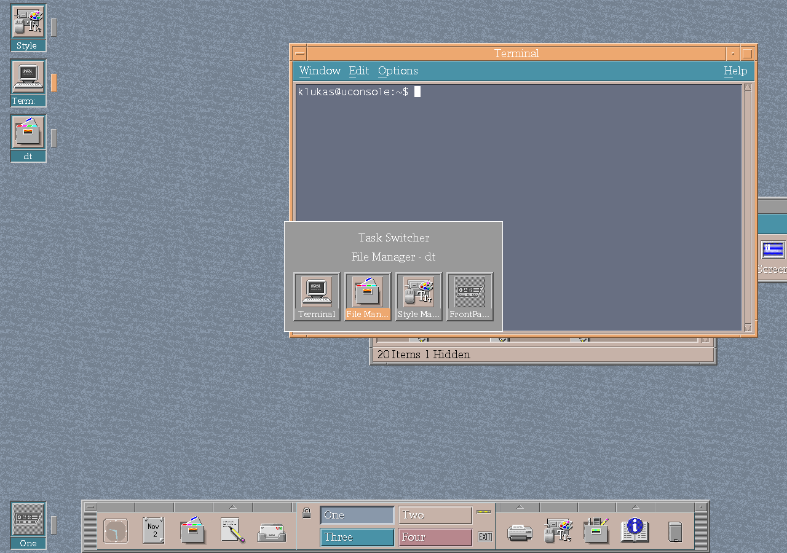

# Window management

CK Core CDE extends dtwm without replacing its workspace, icon or session
model.

## Task switching

The keyboard task switcher presents the available windows, keeps the current
selection visible and supports pointer hover and pinning. It is enabled by the
`Dtwm*showTaskSwitcher` resource.

*The keyboard task switcher running in dtwm on uConsole.*

## Movement and focus

- snap feedback previews half-screen and quadrant placement while moving;
- holding Shift aligns movement and resize to the desktop grid;
- double-clicking a title bar maximizes or restores the window; and
- clicking the desktop clears the active-window focus.

Open-window desktop icons complement these controls by keeping running
applications represented on their workspace.
