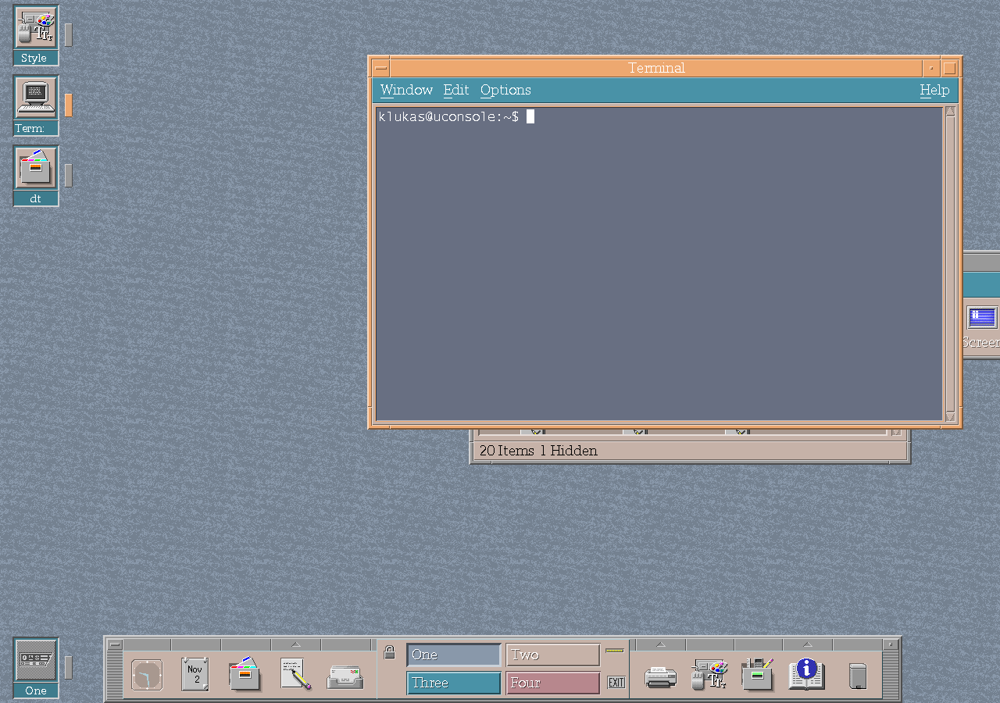

# Window-aware desktop icons

CK Core CDE can retain a desktop icon for each open window. A compact marker
distinguishes the focused window from other open applications, while icons stay
synchronized as windows move between workspaces.

The feature keeps running applications visible in the classic CDE desktop
model, even when their windows overlap or sit behind another application.

*Open-window icons in an automated uConsole session. The marker beside
Terminal identifies the focused window.*

## Configuration

The `Dtwm*showOpenWindowIcons` resource controls the feature and defaults to
enabled in CK Core CDE.

See [Window management](window-management.md) for the related task switcher and
movement features.
