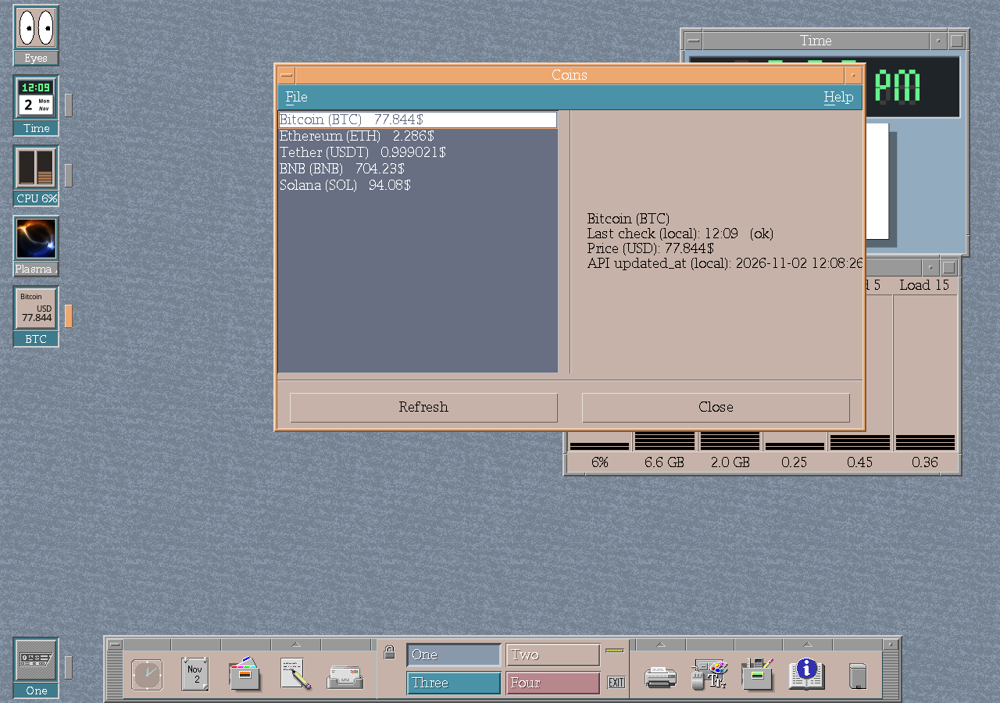

# Window-aware desktop icons

CK Core CDE can retain a desktop icon for each open window. A compact marker
distinguishes the focused window from other open applications, while icons stay
synchronized as windows move between workspaces.

The marker occupies its own reserved desktop space beside the icon. The icon
image and label retain the full configured icon width, including at the normal
32- and 48-pixel sizes.

The feature keeps running applications visible in the classic CDE desktop
model, even when their windows overlap or sit behind another application.

*Open-window icons in an automated uConsole session. The marker beside
Terminal identifies the focused window.*

## Live application icons

Open-window icons can display more than a static application mark. An X11
client can replace its `WM_HINTS` icon pixmap as its state changes, and dtwm
repaints that client-supplied image in the desktop icon. The optional
[CK Core Apps suite](https://cklukas.github.io/ck-core-apps/) uses this contract
for high-resolution live views:

- Clock renders the current time.
- System Load renders CPU and RAM bars.
- Eyes follows the pointer while minimized.
- Browser uses the active tab's favicon.
- Coins shows the selected market price.
- The plasma demo streams animated icon frames while minimized.

Clock, System Load, Browser and Coins can refresh the open-window icon directly.
Eyes and Plasma enter their compact rendering path when their windows are
minimized.

Style Manager's **Increase Icon Size** setting doubles the icon geometry that
dtwm publishes through `WM_ICON_SIZE`. Dynamic clients can query that contract
and render directly at CDE's 32/64 or 48/96 pixel size pair, preserving detail
without relying on cropping or resampling inside the window manager.

*CK Core Apps exercising both open-window and minimized dynamic icons in a
uConsole smoke session built with CK Core Motif ABI 9.*

The applications remain a separate companion project so CDE and the optional
suite can release independently. See
[High-resolution dynamic icons](https://cklukas.github.io/ck-core-apps/dynamic-icons.html)
for the app-owned behavior and update cadence.

## Configuration

The `Dtwm*showOpenWindowIcons` resource controls the feature and defaults to
enabled in CK Core CDE.

See [Window management](window-management.md) for the related task switcher and
movement features.
