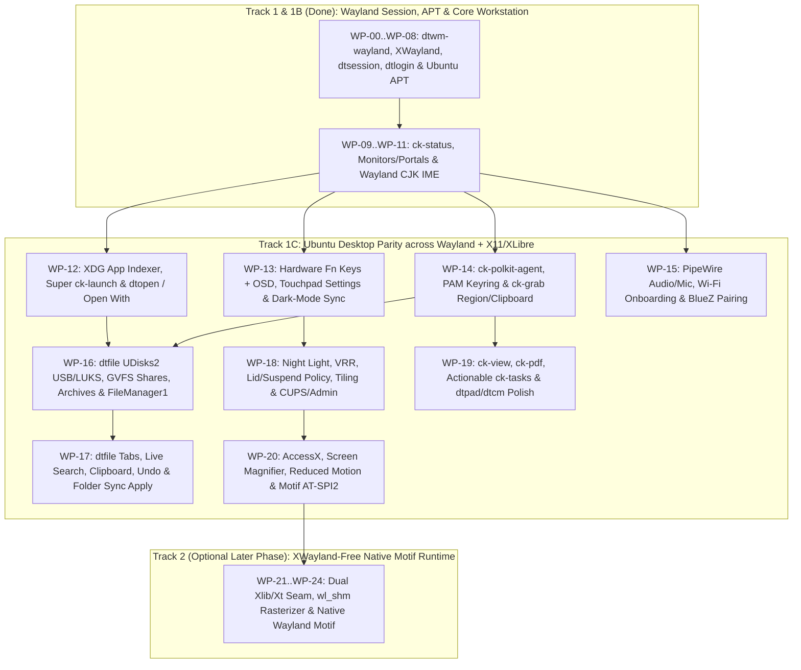

# CK Core CDE & Motif Wayland + X11/XLibre + Ubuntu Work Plan (`WP-00` – `WP-24`)

## Objective and Completion Rule

Deliver a first-class, `apt`-installable **CK Core CDE Desktop Session** supporting both **Wayland (`dtwm-wayland`)** and **classic X11 / XLibre (`dtwm`)** from the same repositories, preserving 100% of CDE's visual and behavioral contracts while closing modern Ubuntu desktop usability gaps (see [`planning/GAPS.md`](planning/GAPS.md)):
- Authentic 3D bevel window frames, resize handles, MWM hints, task switcher, and snap/tile previews across Wayland and X11;
- Instant Front Panel workspace switching, multi-workspace window occupancy, and per-workspace backdrops;
- Open-window desktop icons (`Dtwm*showOpenWindowIcons`), active-focus markers, Front Panel `TYPE client` swallowing (`ck-clock`, `ck-status-gauge`), and live dynamic icons (`ck-clock`, `ck-load`, `ck-eyes`, `ck-coins`, `ck-browser`, `ck-plasma-1`);
- PAM-backed screen locking (`ext-session-lock-v1` on Wayland + `SmLock.c` on X11 via `SmPam.c`);
- Dual-session `dtlogin` replacing `gdm3` cleanly on Ubuntu (`systemd-logind` / `libseat` Wayland greeter + X11 local/XDMCP seats);
- Seamless coexistence of native Wayland apps (Firefox, GTK4/5) and Motif/X11 apps; and
- Full daily-driver workstation & laptop parity (`WP-12`–`WP-20`): XDG `.desktop` app discovery & `Super` quick-launcher, modernized `dtfile` (removable USB/LUKS, `GVFS` shares, archives, tabs, live search, undo), PipeWire audio/mic & Bluetooth/Wi-Fi onboarding, Polkit/Keyring agents, laptop Fn/touchpad ergonomics, Night Light/suspend policy, and accessibility—**delivered for both `CDE (Wayland)` and `CDE (X11 / XLibre)` wherever sensible and verified in parallel**.

## Standing Workspace, Dual-Backend, Build & Qualification Rules

- **Primary branches (`master` / `main`)**: All verified topical commits land directly on `master` (`ck-core-cde`, `ck-core-motif`, `ck-core-fs-lib`) and `main` (`ck-core-apps`), keeping implementation, dual-environment tests, `cde/CHANGES` / `CHANGES` / `CHANGES.md`, and `docs/` together. (The earlier `x11_wayland` integration branch has been merged and retired.)
- **Dual Wayland + X11/XLibre parity & parallel testing (Mandatory for `WP-12`–`WP-20`)**:
  - Every user-facing feature, setting, daemon, and application improvement must be made available to **both `CDE (Wayland)` (`dtwm-wayland` + `dtsession --wayland`) and `CDE (X11 / XLibre)` (`dtwm` + `dtsession`)** wherever technically sensible. Share Motif UI, D-Bus/session logic, `libDtSvc`, `dtfile`, `dtstyle`, and `ck-core-apps` code across both environments, isolating Wayland (`wlroots` / Wayland protocols) vs. X11 (`Xlib` / `Xrandr` / `XInput2` / `XKB` / `Xss`) differences behind narrow backend seams.
  - Every WP acceptance gate must execute **parallel automated tests** against **both** the headless Wayland + rootless `Xwayland` harness (`dtwm-wayland`) **and** the headless X11 harness (`Xvfb` + `dtwm` / `dtsession`), ensuring neither session regresses or lags behind.
- **Mac temporary workspace**: All Mac-side temporary data, Lima ephemeral VM disks (`LIMA_HOME`), caches (`XDG_CACHE_HOME`), scratch artifacts, and logs must live beneath `/Volumes/S8T/tmp/<task-id>` (fallback `/Volumes/PRO-BLADE/tmp` only if `/Volumes/S8T` is unmounted; never `/tmp` or `/private/tmp`).
- **Fast Lima Linux compilation on Apple Silicon (`vz`)**: Compile inside the ARM64 Lima VM on its native Linux ext4 filesystem (e.g. `/var/tmp/ck-wayland-build/<task-id>`, with `TMPDIR` set there) while reading source checkouts from the host Git mount—avoiding VirtioFS metadata overhead during object compilation.
- **Parallelism cap**: Use at most **`-j6`** parallel build or test jobs per task.
- **Matched ABI 9 stack & build freshness**: Pin CK Core Motif ABI 9 (`.ckgit/motif-revision`), build into an isolated prefix, record start/end timestamps, source/binary SHA-256 hashes, and verify `/proc/<pid>/maps` proves every running CDE/Motif binary maps the recorded prefix's `libXm.so.9`. Retain only the current verified build; clean superseded scratch trees after recording `receipt.json`.
- **Topical commits & docs**: Update `cde/CHANGES` / `CHANGES` / `CHANGES.md` and `docs/` (`ckdocs check --config ckdocs.yml --strict`) in the same topic commit as implementation and dual-environment automated tests.

---

## Dependency Overview Across Tracks

---

## Track 1: Full CDE Wayland Session + Rootless XWayland + Ubuntu `dtlogin` (`WP-00` – `WP-08`)

### [x] WP-00 — Mac Lima Ubuntu Qualification VM & Headless Wayland Test Harness
- **Repos**: `ck-core-cde` (`scripts/lima/cde-ubuntu-26.04.yaml`, `scripts/run-lima-wayland-harness.py`, `validation/`)
- **Scope**:
  - Provision an isolated ARM64 Ubuntu 26.04 LTS Lima VM (`vmType: vz`) rooted under `/Volumes/S8T/tmp/`.
  - Install build & Wayland/X11 test dependencies inside the VM (`clang`, `lld`, `libwlroots-dev`, `wayland-protocols`, `wayland-scanner`, `xwayland`, `libseat-dev`, `libinput-dev`, `libxkbcommon-dev`, `libdrm-dev`, `libpixman-1-dev`, `labwc`, `grim`, `wlrctl`, `wayvnc`, `xvfb`).
  - Provide `scripts/run-lima-wayland-harness.py` that builds CK Core Motif (ABI 9) + `ck-core-fs-lib` + CK Core CDE + `ck-core-apps` on VM-local storage (`-j6`), boots a dual-output headless `wlroots` + rootless `Xwayland` session, launches freshly built CDE and `ck-core-apps` clients, verifies `/proc/<pid>/maps` `libXm.so.9` provenance, captures dual-output PNG frames via `zwlr_screencopy_manager_v1` (`grim`), and writes `receipt.json`.
- **Acceptance gate**: Harness runs cleanly from macOS with `TMPDIR`/`LIMA_HOME` under `/Volumes/S8T/tmp`, builds the matched native C23 stack, passes headless dual-output Wayland + XWayland smoke checks, and emits a verified receipt.

### [x] WP-01 — Modern Ubuntu/Debian `.deb` Packaging (`apt install ck-core-cde`)
- **Repos**: `ck-core-motif`, `ck-core-cde` (`cde/debian/`), `ck-core-apps`
- **Scope**:
  - Replace legacy `cde/debian/` metadata with clean Debian/Ubuntu packaging producing `ck-core-motif9`, `ck-core-fs-lib`, `ck-core-cde`, `ck-core-dtlogin`, and `ck-core-apps` without colliding with system `libxm4`.
  - Ship `/usr/share/xsessions/cde.desktop`, `/usr/share/wayland-sessions/cde-wayland.desktop`, `/etc/pam.d/{dtsession,dtlogin}` (with `pam_systemd.so`), and `debconf` `shared/default-x-display-manager`.
- **Acceptance gate**: `apt install ./ck-core-*.deb` succeeds on clean Ubuntu 26.04 LTS with zero broken dependencies and launches verified CDE sessions.

### [x] WP-02 — `dtwm-wayland` Compositor Core, Server-Side CDE Bevel Frames & Rootless XWayland
- **Repos**: `ck-core-cde` (`cde/programs/dtwm/`)
- **Scope**:
  - Implement `wlroots` C23 compositor backend supporting DRM/KMS (`libseat`), nested Wayland, and headless backends, plus `xdg-shell`, `xdg-decoration-unstable-v1` (server-side CDE bevel frames), `zwlr_layer_shell_v1`, `zwlr_screencopy_manager_v1`, and rootless `wlr_xwayland`.
  - Render pixel-identical 3D CDE window frames, titlebars, MWM buttons, resize handles, Shift-grid alignment, double-click maximize, half/quadrant snap feedback, and keyboard task switcher (`Dtwm*showTaskSwitcher`) for both native Wayland and XWayland windows.
- **Acceptance gate**: Automated headless multi-window test verifies identical CDE frames, focus, snap preview, task switcher, and window menu actions across native Wayland and Motif clients under ASan/UBSan.

### [x] WP-03 — CDE Workspaces, Per-Workspace Backdrops & Front Panel Integration
- **Repos**: `ck-core-cde` (`cde/programs/dtwm/`, `cde/lib/DtSvc/DtUtil1/`)
- **Scope**:
  - Implement CDE's workspace model (4 default workspaces, dynamic add/rename/delete, workspace occupancy bitmasks) bridged across `_DT_WORKSPACE_*` / `_DT_WM_REQUEST` XWayland atoms, ToolTalk `DtWorkspace_*` requests, and `ext-workspace-v1`.
  - Render palette-recolored per-workspace CDE backdrops (`WmBackdrop.c`) and dock the genuine CDE Front Panel (`dtwm-panel` / `WmFP.c`) + subpanels with strut geometry respected by maximized Wayland and XWayland windows.
- **Acceptance gate**: Automated test exercises Front Panel workspace switching, *Occupy Workspace...*, and `DtWsmChangeBackdrop` across mixed Wayland/XWayland clients.

### [x] WP-04 — Open-Window Desktop Icons, Live Dynamic Icons, `ck-eyes` & Panel Swallowing
- **Repos**: `ck-core-cde` (`cde/programs/dtwm/`, `cde/programs/dtfile/`), `ck-core-apps`
- **Scope**:
  - Implement `Dtwm*showOpenWindowIcons`, active-focus markers, `WM_ICON_SIZE` (`48/96`), live `WM_HINTS.icon_pixmap` / `xdg-toplevel-icon-v1` streaming (`ck-clock`, `ck-load`, `ck-coins`, `ck-browser`, `ck-plasma-1`), virtual root cursor + icon geometry sync for `ck-eyes`, `dtfile` pinned desktop icons, and Front Panel `TYPE client` swallowing (`ck-clock`).
- **Acceptance gate**: Smoke suite confirms live frame updates and minimized cursor tracking across all dynamic-icon apps.

### [x] WP-05 — Cross-Protocol DnD (Motif ↔ Wayland XDND v5), `ck-grab` Screencopy & Mixed-DPI Scaling
- **Repos**: `ck-core-motif` (`lib/Xm/DragC.c`, `DropSMgr.c`, `XlibreDpi.c`), `ck-core-cde`, `ck-core-apps` (`src/ck-grab/`)
- **Scope**:
  - Add XDND v5 initiator/receiver support alongside Motif DnD + `cde_xdnd_bridge.c` so `dtwm-wayland` bridges Motif ↔ native Wayland `wl_data_device` drops cleanly; add `zwlr_screencopy_manager_v1` capture to `ck-grab`; run XWayland unscaled and publish per-output `XLibre` `DPI` RandR properties consumed by `XlibreDpi.c` alongside `wp_fractional_scale_v1`.
- **Acceptance gate**: Automated tests pass bidirectional `dtfile` ↔ native Wayland drops, `ck-grab` mixed-window screenshots, and 96↔192 DPI live shell reflow.

### [x] WP-06 — `dtsession` Wayland Screen Lock (`ext-session-lock-v1`), Session Startup & `dtstyle` Hardware IPC
- **Repos**: `ck-core-cde` (`cde/programs/dtsession/`, `cde/programs/dtstyle/`, `cde/programs/dtscreen/`, `cde/lib/tt/`)
- **Scope**:
  - Add `dtsession --wayland` session bootstrap (`ttsession` env + XWayland `_SUN_TT_SESSION`, `xrdb`, live `.dp` Color Server palettes, XSMP), `ext-session-lock-v1` screen lock backed by `SmPam.c`, `ext-idle-notify-v1` idle timers, and `dtstyle` Wayland `libinput`/XKB/bell/saver/window IPC.
- **Acceptance gate**: Security tests verify input/screencopy blocking while locked, hotplug output lock coverage, and PAM unlock across Wayland and X11.

### [x] WP-07 — Wayland-Capable `dtlogin` Display Manager for Ubuntu (`systemd-logind` + `libseat`)
- **Repos**: `ck-core-cde` (`cde/programs/dtlogin/`, `cde/lib/DtSvc/DtUtil2/SvcPam.c`)
- **Scope**:
  - Add unprivileged `_dtgreeter` Wayland seat support (`libseat` + `dtwm-wayland --greeter` + `dtgreet`), dynamic `/usr/share/{wayland-sessions,xsessions}` menu population, auto-promotion to Wayland greeter when `/usr/bin/X` is absent, and `pam_systemd` session handoff for `CDE (Wayland)`, `CDE (XLibre / X11)`, and installed Ubuntu desktops.
- **Acceptance gate**: VM service test boots `dtlogin.service`, logs into `CDE (Wayland)`, logs out to `dtgreet`, and logs into `CDE (X11)` cleanly.

### [x] WP-08 — Full Ubuntu LTS Qualification, Documentation & APT Repository
- **Repos**: `ck-core-motif`, `ck-core-cde`, `ck-core-apps`
- **Scope**:
  - Pass full `make check`, sanitizer runs, real-session Wayland + X11 smoke screenshots with `libXm.so.9` provenance, `ckdocs check --config ckdocs.yml --strict`, and signed APT repository verification on Ubuntu 26.04 LTS.

---

## Track 1B: Authentic Sun/IBM CDE Workstation & Laptop Foundations (`WP-09` – `WP-11`)

### [x] WP-09 — `ck-status` & Front Panel Integration: Notifications, Power/Battery, Wi-Fi, Bluetooth & `StatusNotifier` Tray
- **Repos**: `ck-core-apps` (`src/ck-status/`), `ck-core-cde` (`cde/programs/types/dtwm.fp.src`, `cde/programs/dtwm/`)
- **Scope**:
  - Deliver `ck-status` (`org.freedesktop.Notifications` 3D toast banners + history + DND, `StatusNotifierWatcher` tray host, Battery/AC gauge, Wi-Fi/Network & Bluetooth tabs, and `54×48` Front Panel `ck-status-gauge`), central Switch `Notifications` lamp, and slide-up `SystemSubpanel` with persistent **Copy To Main Panel** across both Wayland and X11.
- **Acceptance gate**: Automated notification, `StatusNotifier`, mocked sysfs, and Front Panel persistence checks pass.

### [x] WP-10 — Graphical Monitor Arrangement (`dtstyle` `Display.c` + `wlr-output-management-v1`) & WebRTC Portals
- **Repos**: `ck-core-cde` (`cde/programs/dtwm/wayland/cde_output_mgmt.c`, `cde/programs/dtstyle/Display.c`, `cde/debian/cde-portals.conf`)
- **Scope**:
  - Add `dtstyle` *Monitors* interactive arrangement canvas (layout, edge-snap, rotation, `100%`–`200%` live scale) driving both Wayland (`f.set_output_layout` / `zwlr_output_manager_v1`) and X11/XLibre (`libXrandr`), plus `cde-portals.conf` (`ScreenCast=wlr`, `Screenshot=wlr`).
- **Acceptance gate**: Multi-output Wayland + RandR tests and portal verification pass.

### [x] WP-11 — Native Wayland CJK Input Method Framework (`zwp_text_input_v3` + `zwp_input_method_v2`) & APT Refresh
- **Repos**: `ck-core-cde` (`cde/programs/dtwm/wayland/cde_ime.c`, `cde/programs/dtstyle/I18nEnv.c`, `cde/debian/Xsession.wayland`)
- **Scope**:
  - Implement compositor CJK IME relay (`zwp_text_input_v3`, `zwp_input_method_v2`, `keyboard_grab`, workarea-clamped `zwp_input_popup_surface_v2` candidate popups, lock-screen IME isolation), `dtstyle` `fcitx5`/`ibus` discovery + XWayland `XmIm` sync, and refreshed signed APT qualification.
- **Acceptance gate**: End-to-end CJK preedit/candidate/commit + lock-isolation tests and signed APT install verification pass.

---

## Track 1C: Ubuntu Desktop Parity & Daily-Driver Completeness Across Wayland + X11/XLibre (`WP-12` – `WP-20`)

> **Reference:** Resolves the user-experience gaps cataloged in [`planning/GAPS.md`](planning/GAPS.md). Every WP below targets **both `CDE (Wayland)` and `CDE (X11 / XLibre)`** (wherever sensible) and requires **parallel automated verification** in both environments.

### [x] WP-12 — XDG Application Discovery, `Super` Quick-Launcher (`ck-launch`) & Modernized `dtopen` / *"Open With..."*
- **Closes**: `GAP-LAUNCH-01`, `GAP-LAUNCH-02`, `GAP-LAUNCH-03`, `GAP-FILES-03`
- **Repos**: `ck-core-cde` (`cde/programs/dtappintegrate/`, `cde/programs/dtopen/`, `cde/programs/dtfile/`, `cde/programs/dtwm/`, `cde/programs/types/`), `ck-core-apps` (`src/ck-launch/`, `src/ck-status/`)
- **Dual Wayland + X11 Scope**:
  - **Automatic XDG `.desktop` Indexer (`dtappintegrate --xdg` + session `inotify` watcher):** Scan `/usr/share/applications`, `/usr/local/share/applications`, `/var/lib/flatpak/exports/share/applications`, `/var/lib/snapd/desktop/applications`, and `~/.local/share/applications` at login and on package changes; generate categorized CDE action groups in `~/.dt/appmanager/Desktop_Apps/` with scaled XPM/PNG icons and an optional Front Panel *Applications* subpanel—working identically in `CDE (Wayland)` and `CDE (X11 / XLibre)`.
  - **`Super`-Key Instant Motif Quick-Launcher (`ck-launch`):** Build a fast, keyboard-driven 3D-beveled Motif launcher bound to `Super` and `Alt+F2` in **both** `dtwm-wayland` and classic X11 `dtwm` (`sys.dtwmrc`), supporting instant fuzzy search across XDG `.desktop` apps, CDE actions, open windows (`zwlr_foreign_toplevel_manager_v1` on Wayland; `_NET_CLIENT_LIST` / `_DT_WM_CLIENT_LIST` on X11), `dtstyle` dialogs, and inline calculator expressions.
  - **XDG MIME Integration, `dtopen` Modernization & *"Open With..."*:** Update `dtopen` to consult `xdg-mime` / `~/.config/mimeapps.list` / `xdg-open` and modern Ubuntu viewers (`papers`, `evince`, `loupe`, `eog`, `mpv`, `ck-browser`) ahead of legacy `xv`/`xpdf`; add a Motif *"Open With..."* dialog in `dtfile` listing compatible `.desktop` handlers with a *"Set as default"* toggle; and add software-store launch discovery (*Ubuntu App Center* / `gnome-software` / `synaptic`) plus an optional pending-security-updates indicator in `ck-status`.
- **Parallel Wayland + X11 Acceptance Gate**: Automated tests run in parallel under `dtwm-wayland` and `Xvfb` + X11 `dtwm`, installing synthetic `.desktop` entries and verifying live *Application Manager* refresh, `Super` → `ck-launch` fuzzy app/window activation, and `dtfile` double-click + *"Open With..."* `mimeapps.list` persistence.

### [x] WP-13 — Hardware Media/Brightness Keys + OSD, Laptop Touchpad Settings (`dtstyle`) & Toolkit Dark-Mode Sync
- **Closes**: `GAP-SHELL-01`, `GAP-SHELL-02`, `GAP-SYS-05`
- **Repos**: `ck-core-cde` (`cde/programs/dtwm/`, `cde/programs/dtwm/wayland/`, `cde/programs/dtstyle/`, `cde/programs/dtsession/`)
- **Dual Wayland + X11 Scope**:
  - **Hardware Multimedia, Backlight & Session Keys + 3D Bevel OSD:** Bind `XF86AudioRaiseVolume`, `XF86AudioLowerVolume`, `XF86AudioMute`, `XF86AudioMicMute`, `XF86MonBrightnessUp`, `XF86MonBrightnessDown`, `XF86KbdBrightnessUp/Down`, `XF86AudioPlay/Next/Prev` (MPRIS), `Print` (`ck-grab`), and `Super+L` (`LockDisplay`) in **both** `dtwm-wayland` and X11 `dtwm` (`XGrabKey` / `sys.dtwmrc`), displaying a non-focus-stealing 3D-beveled CDE OSD gauge for volume, mute, and `/sys/class/backlight` (`systemd-logind` `SetBrightness`) changes.
  - **Laptop Touchpad Configuration & Gestures:** Add a **Touchpad** configuration section to `dtstyle` *Mouse* (`Mouse.c`) controlling tap-to-click, natural scrolling, two-finger right-click (`clickfinger` vs. button areas), disable-while-typing, and auto-disable-when-external-mouse-connected—backed by `libinput` IPC on `dtwm-wayland` **and** `XInput2` (`libXi` `libinput *` device properties) on X11/XLibre. Enable 3-finger horizontal touchpad swipe workspace switching on `dtwm-wayland` (`wlr_pointer_gestures_v1`) and XInput2 gesture-capable X11 servers.
  - **Cross-Toolkit Dark/Light Mode Synchronization:** Whenever `dtstyle` / `dtsession` switches between `ModernDark.dp` (`modern_dark`) and light/classic palettes on either Wayland or X11, update `gsettings` (`org.gnome.desktop.interface color-scheme` / `gtk-theme`), D-Bus `org.freedesktop.portal.Settings` (`prefer-dark` / `prefer-light`), and X11 `XSETTINGS` (`Net/ThemeName`) so GTK3/4, libadwaita, Firefox, Chromium, and Qt apps switch dark/light appearance live alongside CDE.
- **Parallel Wayland + X11 Acceptance Gate**: Parallel `dtwm-wayland` and `Xvfb` + X11 `dtwm` tests inject `XF86Audio*` / `XF86MonBrightness*` / `Super+L` keys to verify action + OSD rendering, test `dtstyle` touchpad property updates on both Wayland (`_DT_WAYLAND_INPUT_STATE`) and X11 (`XInput2` mock device), and verify live dark/light theme signals across portals and `XSETTINGS`.

### [x] WP-14 — Polkit Authentication Agent (`ck-polkit-agent`), PAM Keyring Auto-Unlock & Interactive `ck-grab` Region/Clipboard Capture
- **Closes**: `GAP-SYS-02`, `GAP-SHELL-04`
- **Repos**: `ck-core-apps` (`src/ck-polkit-agent/`, `src/ck-grab/`), `ck-core-cde` (`cde/debian/`, `cde/programs/dtlogin/`, `cde/programs/dtsession/`)
- **Dual Wayland + X11 Scope**:
  - **Native Motif Polkit Agent (`ck-polkit-agent`):** Implement `org.freedesktop.PolicyKit1.AuthenticationAgent` communicating with `polkitd` and `polkit-agent-helper-1`, presenting a hardened CDE-palette Motif authentication modal; auto-start in **both** `Xsession.wayland` and X11 `dtsession` startup so `pkexec` and privileged D-Bus admin actions work out of the box in both sessions.
  - **Secret Service Keyring PAM Auto-Unlock:** Configure optional `pam_gnome_keyring.so` (`auto_start`) in `/etc/pam.d/dtlogin` and `/etc/pam.d/dtsession` and start `gnome-keyring-daemon --start --components=secrets,ssh` when present for **both** Wayland and X11 logins so `org.freedesktop.secrets` unlocks automatically for browsers, VS Code, Git, and NetworkManager secrets.
  - **Interactive Region Crop & Direct Clipboard Capture in `ck-grab`:** Extend `ck-grab` with **Region (Drag Rectangle)** selection (`zwlr_layer_shell_v1` crosshair overlay + `zwlr_screencopy_manager_v1` on Wayland; `XGrabPointer` rubber-band crosshair + `XGetImage` on X11) and a **Copy to Clipboard** mode publishing `image/png` directly to `wl_data_device` / X11 `CLIPBOARD` without requiring a file save.
- **Parallel Wayland + X11 Acceptance Gate**: Parallel Wayland and X11 session tests verify `pkexec` elevation through `ck-polkit-agent`, unlocked `org.freedesktop.secrets` after `dtlogin` Wayland and X11 logins, and `ck-grab --region --clipboard` `image/png` round-trip paste in both environments.

### [x] WP-15 — PipeWire / PulseAudio Audio & Mic Routing, Native Wi-Fi Onboarding & Bluetooth Pairing Wizard
- **Closes**: `GAP-SYS-01`, `GAP-SYS-03`
- **Repos**: `ck-core-apps` (`src/ck-mixer/`, `src/ck-status/`), `ck-core-cde` (`cde/debian/control`)
- **Dual Wayland + X11 Scope** *(100% shared Motif + D-Bus/PipeWire clients across Wayland and X11)*:
  - **PipeWire / PulseAudio Backend in `ck-mixer` & `ck-status`:** Add a `libpulse` / PipeWire backend alongside the existing ALSA (`libasound`) backend in `ck-mixer`: enumerate and switch default Output Sinks (speakers, HDMI, USB DAC, Bluetooth headphones) and Input Sources (microphones with gain slider, mute toggle, and live peak meter), select Card Profiles (Bluetooth A2DP vs. HFP/HSP headset mode), adjust per-application playback/capture streams, and run cleanly even when no hardware ALSA card is present.
  - **Native Motif Wi-Fi & VPN Onboarding in `ck-status`:** Add inline WPA2/WPA3-PSK, WPA-Enterprise, and saved-VPN activation/password dialogs directly inside `ck-status` (*Network & Wi-Fi* tab) via `org.freedesktop.NetworkManager` (`AddAndActivateConnection2` + `SecretAgent`), removing reliance on external `nmtui` for everyday connections.
  - **Built-in BlueZ Pairing Agent (`org.bluez.Agent1`) & Media Transport:** Implement `org.bluez.Agent1` inside `ck-status` (*Bluetooth* tab) supporting live device discovery, PIN/passkey confirmation dialogs, `Pair`, `Trust`, and `RemoveDevice`, plus optional MPRIS (`org.mpris.MediaPlayer2`) active track/play-pause controls.
- **Parallel Wayland + X11 Acceptance Gate**: Automated virtual-PipeWire and D-Bus mock tests run under both headless Wayland and Xvfb X11 sessions, verifying sink/source/profile switching, mic controls, `AddAndActivateConnection2` Wi-Fi setup, and `org.bluez.Agent1` pairing round-trips.

### [x] WP-16 — `dtfile` Removable Media (`UDisks2`), Network Shares (`GVFS`), Archives & `FileManager1` Service
- **Closes**: `GAP-FILES-01`, `GAP-FILES-02`, `GAP-FILES-05`
- **Repos**: `ck-core-cde` (`cde/programs/dtfile/`), `ck-core-fs-lib`
- **Dual Wayland + X11 Scope** *(100% shared across Wayland and X11)*:
  - **Removable USB/SD Drives & LUKS Volumes (`UDisks2`):** Subscribe to `org.freedesktop.UDisks2` in `dtfile`, dynamically surfacing hotplugged removable media and encrypted LUKS partitions in `dtfile`'s Shelf / *Devices* strip with one-click `Filesystem.Mount`, Motif LUKS passphrase unlock (`Encrypted.Unlock`), and safe *Unmount / Eject* (`Filesystem.Unmount` + `Drive.PowerOff`).
  - **Network Shares & MTP Phones (`GVFS` / FUSE):** Add **File → Connect to Server...** (`smb://`, `sftp://`, `davs://`, `nfs://`) and MTP/PTP mobile-device discovery backed by `gio mount` / `/run/user/$UID/gvfs` so `dtfile` and POSIX Motif apps browse remote shares and phone storage seamlessly.
  - **Built-in Archive Actions, Shared Thumbnails, Live XDG Trash & `FileManager1`:** Add *Extract Here*, *Extract To...*, and *Compress...* actions for `.zip`, `.tar.gz`, `.tar.xz`, `.tar.zst`, and `.7z`; read shared `~/.cache/thumbnails/{normal,large}` previews for PDFs/videos/SVGs; upgrade `~/.local/share/Trash` integration from one-way startup import to live bidirectional `inotify` + per-mount `.Trash-$UID` support; and register D-Bus `org.freedesktop.FileManager1` (`ShowFolders`, `ShowItems`, `ShowItemProperties`) so browser *"Show in Folder"* focuses `dtfile` and selects the target file.
- **Parallel Wayland + X11 Acceptance Gate**: Parallel Wayland and X11 `dtfile` integration tests verify mocked `UDisks2` mount/LUKS/eject workflows, `FileManager1.ShowItems` window raise + icon highlight, archive extract/compress with adversarial filenames, and live bidirectional XDG Trash updates.

### [x] WP-17 — `dtfile` Browser Ergonomics: Tabs (`Ctrl+T`), Live Search (`Ctrl+F`), Clipboard (`Ctrl+C/X/V`), Undo (`Ctrl+Z`) & Folder Sync Apply
- **Closes**: `GAP-FILES-04`
- **Repos**: `ck-core-cde` (`cde/programs/dtfile/`), `ck-core-fs-lib`
- **Dual Wayland + X11 Scope** *(shared Motif + dual X11/Wayland clipboard interop)*:
  - **Multi-Tab Browsing & Navigation Shortcuts:** Add tabbed directory browsing (`Ctrl+T` new tab, `Ctrl+W` close tab, middle-click folder to open in tab), Back/Forward history (`Alt+Left` / `Alt+Right` + mouse back/forward buttons), `Alt+Up` parent folder, `F2` inline rename, and `Ctrl+H` hidden-files toggle.
  - **Asynchronous In-Window Search (`Ctrl+F`):** Embed a collapsible search bar backed by cancellable `ck-core-fs-lib` recursive filename and content workers (filtering by substring/glob, date range, and size) streaming results into the active `dtfile` view.
  - **Standard File Clipboard (`Ctrl+C/X/V`) & Undo (`Ctrl+Z`):** Publish/consume `x-special/gnome-copied-files` and `text/uri-list` on `CLIPBOARD` (enabling `Ctrl+C`/`Ctrl+X`/`Ctrl+V` file copy/move both within `dtfile` and with GTK/Qt apps on X11 and Wayland) and maintain a bounded per-session undo journal supporting `Ctrl+Z` reversal of rename, move, copy, and Move to Trash.
  - **Enable Validated *Synchronize Folders* Execution:** Complete transactional conflict execution and enable **Apply** in `dtfile`'s `ck-core-fs-lib` Folder Comparison dialog.
- **Parallel Wayland + X11 Acceptance Gate**: Parallel Wayland and X11 `dtfile` + ASan/UBSan `ck-core-fs-lib` suites verify tab navigation, cancellable `Ctrl+F` search, cross-toolkit `Ctrl+C`/`Ctrl+V` file paste (tested against both native Wayland and X11 peers), `Ctrl+Z` undo, and *Synchronize Folders* Apply execution.

### [x] WP-18 — Night Light, VRR, Laptop Lid/Suspend Policy, Keyboard Tiling & CUPS / System Admin Tools
- **Closes**: `GAP-SYS-04`, `GAP-SYS-06`, `GAP-SHELL-03`
- **Repos**: `ck-core-cde` (`cde/programs/dtwm/`, `cde/programs/dtwm/wayland/`, `cde/programs/dtstyle/`, `cde/programs/dtprintinfo/`), `ck-core-apps` (`src/ck-status/`)
- **Dual Wayland + X11 Scope**:
  - **Night Light, VRR & Backlight Persistence:** Add a *Night Light* color-temperature schedule/slider and *Variable Refresh Rate* toggle to `dtstyle` *Monitors*—driving `wlr-gamma-control-unstable-v1` / compositor gamma LUTs and `wlr_output` adaptive sync on `dtwm-wayland`, **and** `XRRSetCrtcGamma` (`libXrandr`) + RandR `VariableRefresh` output properties (when supported by the XLibre driver) on X11—plus persistent display brightness across reboots.
  - **Power Profiles, Idle Auto-Suspend & Laptop Lid Policy:** Add interactive `power-profiles-daemon` / ACPI `platform_profile` switching (*Power Saver* / *Balanced* / *Performance*) in `ck-status` and `dtstyle`, separate AC/battery idle `systemd-logind` suspend timers (`ext-idle-notify-v1` on Wayland; `XScreenSaverQueryInfo` / `Saver.c` on X11), and laptop lid-close policy (suspend on battery vs. docked external-monitor clam-shell mode on both `dtwm-wayland` `WLR_SWITCH_TYPE_LID` and X11 `UPower`/`logind` lid events).
  - **Keyboard Window Tiling (`Super+Arrows`) & CUPS / Admin Panels:** Implement `Super+Left/Right/Up/Down` half/quadrant keyboard window tiling in **both** `dtwm-wayland` and classic X11 `dtwm` (`WmFunction.c`); modernize `dtprintinfo` with driverless CUPS / IPP Everywhere printer enumeration (`libcups`); and provide concise Motif dialogs for *Default Applications* (`mimeapps.list`), *Date, Time & NTP* (`org.freedesktop.timedate1`), and *Firmware Updates* (`fwupd`).
- **Parallel Wayland + X11 Acceptance Gate**: Parallel Wayland (`dtwm-wayland`) and X11 (`Xvfb`/`Xdummy` + `dtwm`) tests verify gamma LUT Night Light updates, `Super+Arrow` window tiling geometry in both window managers, idle/lid suspend policy decisions, and CUPS/`timedate1` mock round-trips.

### [x] WP-19 — Everyday Native Companions (`ck-view` Image Viewer, `ck-pdf` Document Viewer), Actionable `ck-tasks` & `dtpad`/`dtcm` Polish
- **Closes**: `GAP-APPS-01`, `GAP-APPS-02`
- **Repos**: `ck-core-apps` (`src/ck-tasks/`, `src/ck-view/`, `src/ck-pdf/`), `ck-core-cde` (`cde/programs/dtpad/`, `cde/programs/dtcm/`)
- **Dual Wayland + X11 Scope** *(100% shared Motif ABI 9 binaries running natively in both sessions)*:
  - **Actionable `ck-tasks` System Monitor:** Wire **End Process** (`SIGTERM`), **Force Kill** (`SIGKILL` with confirmation), process `renice`, live `/proc/net/dev` RX/TX throughput meters in **Networking**, rolling CPU/RAM history plots in **Performance**, and D-Bus `org.freedesktop.systemd1` service Start/Stop/Restart (authenticated via `ck-polkit-agent`).
  - **Lightweight Motif Image Viewer (`ck-view`) & PDF Viewer (`ck-pdf`):** Deliver `ck-view` (PNG, JPEG, WebP, SVG, XPM, TIFF with zoom/pan, folder next/prev, lossless rotate/crop, and *Set as Workspace Backdrop* via `DtWsmChangeBackdrop`) and `ck-pdf` (`poppler`/`cairo` PDF viewer with outline tree, search, text copy, and CUPS print), registered in both CDE `.dt` datatypes and XDG `.desktop` associations.
  - **Practical `dtpad` & `.ics` Calendar Improvements:** Add optional tabbed documents, recent-files list, line numbers, and crash-recovery autosave to `dtpad`, plus `.ics` (iCalendar) import/export in `dtcm`.
- **Parallel Wayland + X11 Acceptance Gate**: Parallel Wayland and X11 smoke + sanitizer tests verify `ck-tasks` process termination and live network metrics, `ck-view` / `ck-pdf` rendering + session restore + `/proc/<pid>/maps` `libXm.so.9` verification, and `dtpad` crash-recovery restore in both desktops.

### [x] WP-20 — Desktop & Toolkit Accessibility (`AccessX`, Screen Magnifier, Reduced Motion & Motif AT-SPI2 Bridge)
- **Closes**: `GAP-APPS-03`
- **Repos**: `ck-core-cde` (`cde/programs/dtwm/`, `cde/programs/dtwm/wayland/`, `cde/programs/dtstyle/`), `ck-core-motif` (`lib/Xm/`)
- **Dual Wayland + X11 Scope**:
  - **Keyboard Accessibility (`AccessX`), Visual Bell & Reduced Motion:** Add an **Accessibility** panel to `dtstyle` controlling Sticky Keys, Slow Keys, Bounce Keys, Visual Bell (window/screen flash), and Reduced Motion—backed by `dtwm-wayland` input/scene filters on Wayland **and** XKB `XkbSetControls` (`XkbStickyKeysMask`, `XkbSlowKeysMask`, `XkbBounceKeysMask`) + `dtwm` visual bell on X11/XLibre.
  - **Screen Magnification:** Implement smooth cursor-tracking output zoom (`Super+Equal` / `Super+Minus` / `Super+Scroll`) in `dtwm-wayland` alongside a companion XComposite/XFixes magnifier (`ck-magnifier`) for X11 sessions.
  - **Foundational Motif AT-SPI2 Bridge (`libXm.so.9`):** Expose core Motif widget roles, accessible names/labels (`XmLabel`, `XmPushButton`, `XmToggleButton`, `XmText`, `XmTextField`, `XmList`, `CkTable`), focus events, and invoke actions over D-Bus `org.a11y.atspi` identically across Wayland and X11 so the *Orca* screen reader can read CDE and `ck-core-apps` interfaces.
- **Parallel Wayland + X11 Acceptance Gate**: Parallel Wayland and X11 tests verify Sticky/Slow/Bounce key filtering (`dtwm-wayland` and XKB), zoom rendering in both sessions, and `org.a11y.atspi` D-Bus widget-tree inspection of live Motif windows.

---

## Track 2: Pure XWayland-Free Native Motif Runtime (`WP-21` – `WP-24`)

> **Objective:** Enable CK Core Motif ABI 9 (`libXm.so.9`), CK Core CDE (`dtwm-wayland --no-xwayland`, `dtwm-panel`, `dtsession`, `dtstyle`, `dtfile`, `dtpad`, `dtterm`), and `ck-core-apps` to run directly as native Wayland clients **with zero `Xwayland` server process**, while preserving 100% of classic X11 / XLibre compatibility and existing `Xt` / `Xlib` / `Xm` public ABIs when `DISPLAY` is active.

### [x] WP-21 — Dual `Xlib`/`Xt` Display Seam & In-Process Subwindow Virtualizer
- **Repos**: `ck-core-motif` (`lib/Xm/Wayland.h`, `lib/Xm/WaylandBackendI.h`, `lib/Xm/WaylandBackend.c`, `lib/Xm/WaylandX11Server.c`, `configure.ac`), `ck-core-cde` (`cde/programs/dtwm/wayland/`)
- **Scope**:
  - Add an opt-in/auto-activated native Wayland display seam in `libXm.so.9` (`_XmWaylandEnsureDisplay` / `CK_MOTIF_BACKEND=wayland`, auto-engaged when `WAYLAND_DISPLAY` is set and `DISPLAY` is unset) backed by a private `0700` `$XDG_RUNTIME_DIR` in-process UNIX stream endpoint so `libX11` (`XOpenDisplay`), `libXt` (`ConnectionNumber`, `XtAppMainLoop`, `XtAppAddInput`, `XtAppAddTimeOut`), `libXft`, and `cairo` retain genuine `_XDisplay` wire semantics with zero `Xwayland` daemon.
  - Implement the in-process X11 subwindow virtualizer managing window hierarchy, z-order, clipping, `InputOutput` / `InputOnly` geometry, atoms, window properties (`WM_NAME`, `_NET_WM_NAME`, `WM_NORMAL_HINTS`, `_MOTIF_WM_HINTS`, `WM_PROTOCOLS` / `WM_DELETE_WINDOW`), passive/active pointer and keyboard grabs, `xkbcommon` keymaps, and full `Expose` / `ConfigureNotify` / `MapNotify` / `EnterNotify` / `LeaveNotify` / `FocusIn` / `KeyPress` / `ButtonPress` / `MotionNotify` synthesis.
  - Map realized non-override-redirect top-level shells (`VendorShell` / `TopLevelShell` / `DialogShell`) to native Wayland `xdg_toplevel` surfaces negotiating `zxdg_toplevel_decoration_v1` server-side CDE 3D bevel frames and `xdg_toplevel_icon_v1` dynamic icons, and export `<Xm/Wayland.h>` (`XmWaylandIsActive`, `XmWaylandLock`, `XmWaylandUnlock`, `XmWaylandGetDisplayHandles`, `XmWaylandGetWidgetSurface`, weak `ck_motif_prefer_x11`).
- **Acceptance gate**: Automated headless Wayland test (`dtwm-wayland --no-xwayland` + `tests/automated/run-wayland-backend.py`, `pgrep -x Xwayland` empty) launches Motif shell/form/button/text fixtures, verifies `/proc/<pid>/maps` maps `libXm.so.9`, and exercises resize, focus, keyboard input, button activation, child-process socket isolation, and `WM_DELETE_WINDOW` close alongside unchanged Xvfb X11 regression runs.

### [x] WP-22 — Pixman / `wl_shm` Widget Rasterizer, FreeType/HarfBuzz Blitter & `xdg_popup` Menus
- **Repos**: `ck-core-motif` (`lib/Xm/WaylandRender.c`, `lib/Xm/WaylandBackend.c`)
- **Scope**:
  - Back virtualized windows and `Pixmap`s with 32-bit `ARGB8888` / `XRGB8888` `pixman_image_t` surfaces blitted into pooled `wl_shm` buffers with damage tracking (`wl_surface_damage_buffer`) and frame-callback pacing.
  - Implement Core X11 GC rasterization (`PolyFillRectangle`, `PolyRectangle`, `PolyLine`, `PolySegment`, `FillPoly`, `PolyArc`, `PolyFillArc`, `CopyArea`, `CopyPlane`, `PutImage`, `GetImage`, `PolyText8/16`, `ImageText8/16`, stipples/tiles including `50_foreground` CDE bevels, and clip masks/rectangles) plus the `RENDER` (`XRender` 0.11) extension (`CreatePicture`, `Composite`, `FillRectangles`, `Trapezoids`, `Triangles`, `CreateSolidFill`, `CreateLinearGradient`, `CreateRadialGradient`, `AddGlyphs`, `CompositeGlyphs8/16/32`) so `libXft` / FreeType / HarfBuzz anti-aliased text and modern rounded profiles render with pixel fidelity.
  - Map override-redirect transient/menu shells (`XmMenuShell` pulldowns, popup menus, option menus, combo dropdowns) to native Wayland `xdg_popup` surfaces (`xdg_positioner` anchor rect, gravity, flip/slide workarea constraints, and LIFO `xdg_popup_grab` dismissal).
- **Acceptance gate**: Automated XWayland-free Wayland + X11 tests verify Classic CDE 3D bevels, `modern_light` / `modern_dark` / `high_contrast` appearance profiles, FreeType/HarfBuzz UTF-8/CJK glyph rendering, and nested `xdg_popup` menu bar / popup menu / option menu interaction.

### [x] WP-23 — Native Wayland Selections, DnD (`wl_data_device`), `zwp_text_input_v3` IME & `wp_fractional_scale_v1`
- **Repos**: `ck-core-motif` (`lib/Xm/WaylandData.c`, `lib/Xm/WaylandIme.c`, `lib/Xm/WaylandBackend.c`, `lib/Xm/XmIm.c`, `lib/Xm/Display.c`, `lib/Xm/DropSMgr.c`)
- **Scope**:
  - Bridge `CLIPBOARD` and `PRIMARY` (`wl_data_device` + `zwp_primary_selection_v1`) bidirectionally (`SetSelectionOwner`, `ConvertSelection`, `SelectionRequest`, `SelectionNotify`) across `UTF8_STRING`, `text/plain;charset=utf-8`, `text/uri-list`, `x-special/gnome-copied-files`, and `image/png`.
  - Bridge Motif `XmDragContext` / XDND v5 drag-and-drop bidirectionally with `wl_data_device_start_drag` and `wl_data_offer` (`enter`, `motion`, `leave`, `drop`, 32-bit ARGB drag icon surface).
  - Connect `zwp_text_input_v3` (`preedit_string`, `commit_string`, `delete_surrounding_text`, `set_cursor_rectangle`) directly to focused Motif `XmText` / `XmTextField` widgets, and wire `wp_fractional_scale_v1` + `wp_viewporter` + `wl_output` physical buffer scaling (preserving 96-DPI logical coordinates) alongside explicit `CK_MOTIF_WAYLAND_SCALE` live toolkit zoom reflow.
- **Acceptance gate**: Automated XWayland-free tests verify bidirectional clipboard text/URI/PNG copy-paste with native Wayland peers, drag-and-drop file transfer, `zwp_text_input_v3` CJK preedit/commit, and `100%`↔`200%` fractional/integer scale handling.

### [x] WP-24 — Unify External X11 Bypasses (`ck-clock`, `ck-coins`, `ck-browser`, `dtfile`) & `--no-xwayland` Session
- **Repos**: `ck-core-cde` (`cde/programs/dtwm/wayland/`, `cde/programs/dtsession/`, `cde/programs/dtstyle/`, `cde/programs/dtfile/`), `ck-core-apps` (`src/ck-clock/`, `src/ck-coins/`, `src/ck-browser/`)
- **Scope**:
  - Add `--no-xwayland` (`-X` / `DTWM_WAYLAND_NO_XWAYLAND=1`) support to `dtwm-wayland` and `dtsession --wayland`, native `xdg_toplevel` Front Panel & Subpanel docking (`dtwm-front-panel` / `dtwm-subpanel`) for `dtwm-panel`, and an XWayland-independent compositor IPC transport (`$XDG_RUNTIME_DIR/dtwm-wayland-<WAYLAND_DISPLAY>.ipc` syncing `RESOURCE_MANAGER`, `_DT_WM_REQUEST`, and `_DT_WORKSPACE_CURRENT_NAME`) for `dtwm-panel`, `dtstyle`, `dtsession`, and `dtfile`.
  - Unify application X11 bypasses so all four apps run cleanly both with X11/XWayland and under `--no-xwayland`:
    - `ck-clock`: Cairo/XRender blitting + native Wayland window mode and `xdg_toplevel_icon_v1` dynamic clock icon without requiring XWayland;
    - `ck-coins`: toolkit/XRender-clean canvas & dynamic icon rendering publishing `xdg_toplevel_icon_v1`;
    - `ck-browser`: native Wayland startup without `DISPLAY` using `<Xm/Wayland.h>` (`XmWaylandGetDisplayHandles`, `XmWaylandGetWidgetSurface`) to embed CEF off-screen rendering (`CefRenderHandler` + `wl_shm` + `wp_viewporter`) in a synchronized `wl_subsurface` at full HiDPI physical resolution while preserving `CefWindowInfo::SetAsChild` on X11;
    - `dtfile`: non-rectangular `XShape` cutouts translated to `wl_surface` alpha + `wl_region` input masks and `DefaultRootWindow` session IPC broadcasts.
- **Acceptance gate**: End-to-end Ubuntu VM qualification (`check-dtwm-wayland-wp24-noxwayland.py`) boots `dtwm-wayland --no-xwayland` (zero `Xwayland` processes), launches `dtwm-panel`, `dtsession`, `dtstyle`, `dtfile`, `dtpad`, `ck-clock`, `ck-coins`, and `ck-browser`, verifies `libXm.so.9` provenance in `/proc/<pid>/maps`, captures verified session screenshots, and passes parallel hybrid/X11 regression checks.
